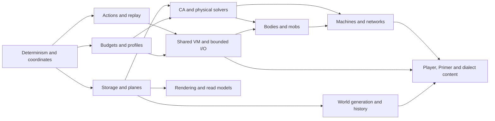

# Underkingdom: reconciled master plan

Status (2026-10-24): **approved with amendments** by the human review of the
session-2 draft. Amendments are applied here and in
[decision 0022](decisions/0022-master-plan-review.md). No spike, SDD or claim has
passed yet; table entries are targets until their receipts exist.

## 1. Inputs of record (frozen)

1. [ENGINE_CORE_PROMPT_v2](specs/ENGINE_CORE_PROMPT_v2.md)
2. [MOD_ADDENDUM](specs/MOD_ADDENDUM.md)
3. [ADDENDUM_B_HARDWARE](specs/ADDENDUM_B_HARDWARE.md)
4. [GAME_BIBLE](specs/GAME_BIBLE.md)
5. The tooltip contract (§7 below)
6. The master-plan review recorded in [decision 0022](decisions/0022-master-plan-review.md)
7. [W-GEO/HYDRO/BIO](specs/W_GEO_HYDRO_BIO.md), the worldgen specification, added by the human after the freeze ([decision 0023](decisions/0023-worldgen-spec-input.md))

Intake is closed: no further Downloads intake, coverage registers or
reconciliation passes. The [download coverage register](plans/download-coverage/README.md)
and [Downloads intake](specs/downloads-2026-10-24/README.md) are archived as
historical; scope is not routed from them again. Project Axiom revision 4 is not
an input of record, so its implementation track is
[parked](parked/README.md) for M1–M3; work on it stops unless the human reopens it.
Code it already landed stays as legacy substrate.

Supporting context (not inputs of record): [research](research/README.md),
[engine roadmap](ENGINE_CORE.md), [game roadmap](GAME_DESIGN.md),
[architecture](ARCHITECTURE.md), ADRs 0001–0020 (0013 absent),
[decisions](decisions/README.md), and the current playable
[workshop-to-dungeon loop](plans/2026-10-24-workshop-dungeon-loop.md).

Source facts this plan relies on:

- Save **32**, generator **48** at this pass (`world/storage.rs`,
  `voxel/src/config.rs`). Other sessions are active: reread both before any
  migration and pick the new save version against then-current source.
  Never edit a historical version gate.
- The integer CA (`engine_sim`) and its byte-identical GPU port (`engine_sim_gpu`)
  exist. Ordinary play still uses legacy authority; ADR 0018's sealed CPU region is
  the only path on the new backend.
- Reuse status: `L` = legacy/partial substrate exists, `P` = design only. Both
  still need their SDD and integration.
- Keep the six product pillars, seven audience paths, current controls, saves and
  world identities. Working title stays *Underkingdom*; the
  [naming proposals](research/naming-proposals.md) are unselected.

## 2. System inventory, tiers and dependencies

Each row is one B.2 system. Owner is the domain in the ID prefix; each
implementation session names its single writer. SDDs live at
`docs/systems/<ID>.md` under the [system-design protocol](systems/README.md).

**SDD tiers** (replaces "every system gets fourteen sections"):

| Tier | Applies to | Design artifact | Review |
|---|---|---|---|
| A | C01–C10, C14–C17, V01, V02, B01–B05, N01–N06, M01, M05, M07, M09, W01, W02, W12, W13, R01, R02, R04 (38) | Full fourteen-section SDD | Independent critic; all 12 rubric rows 2/2; three-round cap |
| B | Every other system that owns state | Mini-SDD: sections 1, 3, 4, 6, 9, 13 | One critic pass, no rounds |
| C | Content-only systems: M17, P06, P11, P15, P18, P20, X05, and most A.x feature-matrix rows | RON schema + validator rules + one scenario | None beyond validator and scenario |

Promoting a system to a higher tier needs a one-line reason in its row.

Dependency layers: core contracts → storage/planes/actions/budgets → solvers
and VM → entities/networks/content → player experiences and world narratives →
acceptance. UI, rendering and telemetry consume read models and events; they never
become prerequisites for authoritative state. Feedback between systems uses
tick-stamped events/actions, not cyclic ownership.

The table is the complete graph (149 nodes; W11–W19 come from the worldgen spec). First milestone is the earliest
contracted capability; adapters also wait for their named prerequisites.

| ID | Separate system | Tier | First milestone | Prerequisites | Reuse status / evidence anchor |
|---|---|---|---|---|---|
| C01 | det/fixed-point | A | M1 | — | L: core hash, sim pinned integers; bodies still float |
| C02 | coords/scale | A | M1 | C01 | L: core/voxel coordinates; mixed-resolution conservation pending; SDD reserves cube-sphere face id and cross-edge rotation (0024) |
| C03 | brick storage/pool/awake | A | M1 | C02 | L: sim store; sim_gpu resident; sparse CPU activity |
| C04 | CA kernel framework | A | M1 | C01,C03,C14,C17 | L: sim step, GPU kernel; eight-phase Margolus unless S1 shows >=25% gain (0022) |
| C05 | powder | A | M1.5 | C04 | L: property-driven movement; momentum pending |
| C06 | liquid | A | M1 | C04 | L: 64-level CA, legacy fractional water; pressure pending |
| C07 | gas | A | M1.5 | C04 | L: movement/reactions; mixture/oxygen pending |
| C08 | thermal | A | M1.5 | C04 | L: climate ambient, table-driven conduction, latent fusion (window game); exact ledger and `engine_sim` ambient pending |
| C09 | reactions/fire | A | M1.5 | C08 | L: reactions.ron; oxygen and complete pair policy pending |
| C10 | support/collapse | A | M1.5 | C04 | P: authoritative support relaxation and collapse events |
| C11 | light | B | M1.5 | C03,C14 | L: voxel/render light; gameplay planes pending |
| C12 | weather/seasons | B | M3 | C07,C08,C11 | L: day/weather and environmental work; seasonal coupling pending |
| C13 | growth/biology | B | M3 | C08,C11,C14 | L: environmental groundcover; tree/ecology extensions pending |
| C14 | planes manager | A | M1 | C03 | P: ADR0015 plus A.15 fields and byte admission |
| C15 | actions/replay/desync | A | M1 | C01,C02 | L: isolated commands only; global Action/replay pending |
| C16 | save/paging | A | M1 | C03,C15 | L: storage/regions; exact new-backend checkpoints pending |
| C17 | budgets/governor | A | M1 | C01 | L: Budget; deterministic per-tick quotas authoritative, wall time only for render/mesh (0022) |
| C18 | profiles/caps | B | M1 H1/desktop; M1.5 other classes | C17 | P: H1 and desktop profiles for the slice; H0/H2-H5 capability/fallback contracts at M1.5 |
| C19 | overlay/telemetry | B | M1.5 | C17 | L: F3/GPU profiler; cross-system evidence schema pending |
| C20 | jobs/threads | B | M1.5 | C01,C17 | L: streaming workers; deterministic commit boundary pending |
| C21 | audio | B | M1.5 voice caps; M2 physical | C15 | L: early voice/occlusion budget; physical event/reverb integration pending |
| B01 | body table | A | M2 | C01,C15 | L: legacy rigid; generational brick bodies pending |
| B02 | body creation/floodfill | A | M2 | B01,C10 | L: bounded CPU extraction; GPU extraction deferred ADR0011 |
| B03 | body integration | A | M2 | B01,C06,C07 | L: CPU floats; fixed-point decided (0022), migration designed in B01's SDD |
| B04 | body contacts | A | M2 | B03,C03 | L: legacy contacts; target queries/readback pending |
| B05 | body resolve | A | M2 | B04 | L: target impulse/friction semantics pending |
| B06 | body fracture | B | M2 | B05 | P: energy-driven material splits |
| B07 | body fuse | B | M2 | B05,C15 | L: legacy voxelization; conservative re-fuse pending |
| B08 | body joints | B | M2 | B05 | P: hinge, slider, fixed and load-bearing ropes |
| B09 | body controllers | B | M2 | B03,C15,V03 | P: shared vessel/missile/quarry/train/drone/rover/airship/golem contract |
| N01 | mob table | A | M2 | C01,C15 | L: adventure enemies; generic table pending |
| N02 | mob movement | A | M2 | N01,C03 | L: current steering/collision; mirror migration pending |
| N03 | nav summaries | A | M2 | C03,C17 | P: dirty-brick summary and portals |
| N04 | HPA | A | M2 | N03 | L: bounded existing search; hierarchical cache pending |
| N05 | senses | A | M2 | N01,C11,C14,C15 | P: sight/scent/hearing/vibration integration |
| N06 | utility AI | A | M2 | N02,N04,N05 | P: RON considerations and action emission |
| N07 | mob LOD | B | M2 | N06,C17 | P: reproducible distant service and idle rates |
| N08 | factions/reputation | B | M3 | N01,C15 | P: persistent attitudes and consequences |
| N09 | villagers/jobs | B | M3 | N06,N08 | P: job sites, homes, trades and schedules |
| N10 | taming/breeding | B | M3 | N06,X01 | L: habitat work; shared breeding/genetics pending |
| N11 | bosses | B | M6 | N06,B06 | L: bestiary/bosses; physics gate acceptance pending |
| N12 | crew | B | M6 | N06,N09,B09 | P: job-driven seal/repair/evacuate |
| M01 | machine table | A | M3 starter; M4 full | C15 | L: factory and machines.ron; M3 admits one water-driven processor through this same table |
| M02 | machine buckets | B | M4 | M01,C17 | L: factory cadence; deterministic divisors pending |
| M03 | machine inventories | B | M3 | C15 | L: inventory/storage; flat reservation contract pending |
| M04 | multiblocks | B | M4 | M01,M03 | L: existing machines; shared shape/ownership migration pending |
| M05 | transport cells | A | M3 starter; M4 full | C06,C07,C14,M03 | L: packet pipes; M3 gravity feed, M4 belts/tubes/multichannel extension |
| M06 | inserters | B | M4 | M03,M05 | P: face filters, reach and atomic transfers |
| M07 | electric network | A | M4 | C15,C08 | L: integer factory power; voltage/loss/overvoltage pending |
| M08 | kinetic network | B | M3 starter; M4 full | B08,C15 | P: M3 waterwheel/axle drive; M4 branching/stress/overload extension |
| M09 | signal network | A | M4 | C15 | P: canonical graph evaluation, registers, gates |
| M10 | link network | B | M4 | M03,C15 | P: frequency/owner, range, transfer energy and admission |
| M11 | heat/steam network | B | M4 | C06,C07,C08 | P: shared fields, pipes and temperature deltas |
| M12 | mana network | B | M5 | G01,C15 | P: shared plane and graph adapters |
| M13 | neutron field/network | B | M4 | C09,C14 | P: moderation/absorption and geometry-driven criticality |
| M14 | radiation field/network | B | M4 | C09,C14 | P: emission, attenuation, contamination and decay |
| M15 | generators | B | M3 starter; M4 full | M08,C09,C15 | L: M3 waterwheel conversion; electric and steam adapters wait for M07/M11 in M4; all losses pending |
| M16 | processing chains | B | M3 starter; M4 full | M01,C09 | L: M3 single-machine resource processing; multiblock/reagent chains wait for M04 in M4 |
| M17 | augments/modifiers | C | M3 | C15 | L: wand/tool modifiers; common stacking evaluator pending |
| M18 | digital storage | B | M4 | M03,M10 | L: storage; indexed request/capacity semantics pending |
| M19 | autocraft | B | M4 | M18,M16 | P: recipe graph jobs/reservations and cancellation |
| M20 | builder/quarry | B | M4 | B09,M03,C15 | L: creative edits; physical budgeted builders pending |
| M21 | field emitters | B | M4 | C14,C15,M17 | P: shared shape/filter/plane operations/cost evaluator |
| M22 | forcefields | B | M4 | M21,M07 | P: selective collision, liquid/gas coupling, breach |
| M23 | pocket worlds | B | M6 | W08,C16 | P: region ownership and nested parent interfaces |
| M24 | matter compiler/Feed | B | M7 | M19,V03,C09 | P: elemental ledger, Feed transport, information cost |
| G01 | mana/aspects planes | B | M1.5 spike (S7); M5 content | C14,C08 | L: mana player stat/resonance candidate; physical plane pending |
| G02 | wands/cards | B | M5 | G01,M17,V01 | L: ordered deck/spells.ron; common compiler pending |
| G03 | projectiles | B | M2 | C15,B04 | L: adventure projectiles; shared physical table pending |
| G04 | runes | B | M5 | V03,V04,M09,G01 | P: mana signal with shared instruction semantics |
| G05 | rituals | B | M5 | M04,G01,V03 | P: conditions, effect sequence, backfire |
| G06 | alchemy/secret recipes | B | M5 | C09,G01,W06 | L: reactions; seeded grammar and hint synthesis pending |
| G07 | enchanting | B | M5 | M17,G01 | P: rule attachments and conserved costs |
| G08 | constructs | B | M5 | N06,B09,G01 | P: owner-bound material-bodied workers |
| G09 | language of the Work | B | M7 | V04,G04,G08 | P: glyph programs, utility-weight effects and counterplay |
| V01 | VM bytecode | A | M1.5 | C01,C15 | P: shared typed instruction semantics; spike S6 at M1.5 |
| V02 | VM sandbox | A | M1.5 | V01,C17 | P: instruction/memory caps, deterministic yield/fault |
| V03 | VM I/O | B | M2 | V02,C15 | P: snapshot queries and versioned bounded action requests |
| V04 | glyph front end | B | M2 | V01,V02 | P: notation compiles to the same bytecode |
| V05 | text/node front ends | B | M2 | V01,V02 | P: common IR, text and visual editing |
| V06 | cryptography primitives | B | M7 | V03,M09 | P: honest toy ciphers, key items and explicit limits |
| W01 | worldgen stages | A | M1.5 | C01,C02 | L: worldgen crate; owns W-GEO P12 realization, G0–G3 grids and version policy |
| W02 | civilizations generator | A | M6 | W01 | P: names/culture/architecture/religion/economy/downfall; S10 |
| W03 | strata | B | M6 | W01,W02 | L: underground/depth generation; coherent histories pending |
| W04 | structures | B | M3 | W01 | L: architecture/sites/dungeons; functioning templates pending |
| W05 | POIs | B | M3 | W04 | L: sites; named roles and spacing acceptance pending |
| W06 | secrets generator | B | M5 | W01,C15 | P: seeded conditions and discoverable hint chains |
| W07 | ages/catastrophes/archives | B | M7 | W02,C16,C15 | P: physical knowledge preservation and new-age inheritance |
| W08 | dimensions/physics constants | B | M6 | C16,C18,W01 | P: per-world constants (incl. planet size, default 32 km face edge) and transfer interface |
| W09 | space layer/orbital | B | M6 spike; M7 target | B09,W08 | L: recovered orbital gameplay is not patched-conic physics; S9 |
| W10 | ring | B | M7 | W09,W02 | L: orbital/skyhook narrative substrate; Founder ring pending |
| W11 | tectonics/lithology/volcanism (W-GEO P0–P1) | B | M3 | W01 | P: plates, strata stack with erodibility/permeability, faults, volcanoes |
| W12 | climate planning (W-GEO P2, P8 microclimate) | A | M3 | W01,W11 | P: insolation, circulation, orographic rain, wind field; runtime fields via C12; lat/long from cube-sphere projection (0024) |
| W13 | erosion/drainage/hydrology network (W-GEO P3–P4) | A | M3 | W11,W12,C02 | L: interim gen-50 meandering drainage.rs; target stream power, priority-flood lakes, Q/Strahler/groundwater |
| W14 | coasts (W-GEO P5) | B | M4 | W13 | L: beaches/coast bands; cliffs/deltas/estuaries/reefs and tides pending |
| W15 | channel planform (W-GEO P6) | B | M3 | W13 | P: step-pool/riffle/meander/braid classes, cutoffs, confluences, waterfalls |
| W16 | karst/caves/springs (W-GEO P7) | B | M6 | W13,W03 | L: existing caves; groundwater-driven karst and springs pending |
| W17 | soils (W-GEO P8) | B | M3 | W11,W12,W13 | P: depth/type planes feeding fertility and moisture (P07, C13) |
| W18 | biome assembly/vegetation (W-GEO P9) | B | M3 | W12,W17,C13 | L: environmental groundcover and trees; tolerance-curve communities and succession pending |
| W19 | wonders/vistas/names/roles (W-GEO §10) | B | M6 | W13,W18,W05,W02 | P: wonder scheduler, framing, phonotactic names, roles, variety validator |
| P01 | player | B | M3 | C15 | L: player capsule/input; target state migration pending |
| P02 | needs | B | M3 | P01,C08,C14 | L: health/hunger/mana; oxygen/thirst/profile coverage pending |
| P03 | player inventory | B | M3 | M03 | L: hotbar/backpack/armor; shared ownership contract pending |
| P04 | tools/parts/traits | B | M3 | P03,M17 | L: tinkering; material-derived physics/coverage pending |
| P05 | crafting | B | M3 | P03 | L: recipes/browser and staged admission |
| P06 | cooking | C | M3 | P05,C08 | P: time/temperature/vessel rules |
| P07 | farming | B | M3 | C13,P03 | L: environmental/habitat work; full player loop pending |
| P08 | building variants/schematics | B | M3 | P03,C15 | L: creative tools/variants; durable ghosts/schematics pending |
| P09 | combat | B | M3 | P01,G03,M17 | L: current combat; shared physical hazards pending |
| P10 | vehicles/vessels | B | M6 | B09,N12,M07 | L: orbital/expedition gameplay; body subsystems pending |
| P11 | trade | C | M3 | N09,P03 | P: persistent offers and faction consequences |
| P12 | advancements/quests | B | M3 | C15 | P: demonstrated-state criteria, rewards and save ownership |
| P13 | run modes: delve/expedition | B | M6 | P01,C16,W05 | L: expedition path; permadeath/world-persistence contract pending |
| P14 | Primer | B | M3 | P12,C15,P16 | P: early adaptive artifact; demonstrate experiment, not read page |
| P15 | codex | C | M3 | P12 | P: discoveries and optional <=50-word entries |
| P16 | text layer/parser/descriptions | B | M3 | C15,W05 | P: read-model nouns, legal verbs, synonyms and grounded descriptions |
| P17 | UI schemas | B | M1.5 startup; M3 game | C15 | L: early hardware settings/progress schema; inventory/machine adapters wait for M03 in M3 |
| P18 | tooltips | C | M3 | P17 | L: strict inventory and all 94 spell records migrated; native compact/expanded spell cards reviewed; machine migration and full interaction review pending |
| P19 | accessibility | B | M3 start; M7 finish | P17 | L: scale/font work; remapping/controller/color review pending |
| P20 | localization | C | M3 | P17 | P: stable keys, templates, locale-safe word limits |
| P21 | modding overlays | B | M7 | C16,T02 | P: validated overlays/versioned VM programs |
| R01 | GPU meshing | A | M1.5; S3 deferred until M1 numbers | C03 | L: CPU greedy; existing renderer serves the slice, GPU choice after S3 |
| R02 | indirect/culling | A | M1 existing path as-is; M1.5 upgrades | R01 | L: arena/multidraw/CPU frustum; GPU Hi-Z pending |
| R03 | shadows | B | M1.5 | R02 | L: cascade renderer; per-cascade lists pending |
| R04 | volumes | A | M1 | C14,R02 | L: atmosphere; CA-derived gas/fire/mana pending |
| R05 | water | B | M1 | C06,R02 | L: existing surface/fraction views; revised physical presentation pending |
| R06 | sky/weather | B | M3 | C12,R04 | L: existing cloud/sky; gameplay coupling pending |
| R07 | light/emissive | B | M1.5 | C11,R02 | L: renderer materials/lighting |
| R08 | particles | B | M2 | C15,R02 | L: effects; conserved ballistic matter pending |
| R09 | bodies instanced | B | M2 | B01,R02 | L: renderer entity paths; brick-body instances pending |
| R10 | far LOD | B | M1.5 spike | C02,R01,W01 | L: horizon/mesh tiers; conservative simulation LOD pending |
| R11 | upscaling | B | M1.5 basic; M7 FSR | R02,C18 | P: early resolution/bilinear ladder; later FSR and image acceptance |
| R12 | post | B | M7 | R02 | L: current post effects; profile/accessibility pass pending |
| R13 | materials: procedural/atlas | B | M1.5 spike | R02 | L: shaders/material assets; choice remains evidence-based |
| R14 | UI rendering | B | M1.5 startup; M3 game | P17 | L: early profile/load presentation, later complete game-schema rendering and review |
| R15 | map/preview | B | M3 | W05,C03 | P: world summary, POIs and selection views |
| T01 | scaffolds | B | M3 | T02 | P: data/schema/scenario generators; no new tests now |
| T02 | validators | B | M1.5 | C01 | L: content/description validators and runtime spell-copy coverage; reachability/cycles and broader machine copy adoption pending |
| T03 | scenario recorder | B | M3 | C15,C16 | P: durable actions and assertions |
| T04 | replay bug reports | B | M2 | C15,C16 | P: seed/version/action log/evidence bundle |
| T05 | benches | B | M1 | C19 | L: existing scripts/baselines; slice runs follow the spike protocol |
| T06 | class profiles | B | M1 H1 only; M1.5 other classes | C18 | P: Addendum B H0-H5; Iris Xe (H1) inventory in session 2, other classes M1.5 |
| T07 | CI matrix | — | Deferred | T05,T06 | Explicitly not authorized; retain as scope without adding hosted CI |
| T08 | docs lint | B | M1.5 | T02 | L: repo path checks; master/SDD/reference consistency pending |
| X01 | genetics evaluator | B | M3 base; M5 depth | C01,C14 | P: A.15 shared allele/dominance/mutation conditions |
| X02 | security/access | B | M4 | M09,M10,M22 | P: identities, keypads/readers/cameras/logs |
| X03 | nuclear/accelerator content | B | M4 fission; M7 fusion | M13,M14,M21 | P: isotope data, beam entity, coolant/containment |
| X04 | danger/failure ledger | B | M1.5 onward | C09,C15 | P: every energy form has explicit failure rows and conserved accounting |
| X05 | education names/units | C | M3 onward | T02,C18 | P: cited constants, fictional labels and lesson review |

Each SDD expands its edges, proves acyclicity at module/API level and names every
state owner. B09 consumes VM I/O rather than owning the VM; M23 consumes world
interfaces rather than W08 depending on pocket worlds.

## 3. Milestones

### M1: vertical slice

M1 is one playable thing, not a foundation layer. **Exit:**

- `dam_break_200k` runs on the integer backend, authoritative for the player's
  region: ADR 0018's region expanded to a radius of 3 bricks around the player.
- GPU kernel output is bit-exact with the CPU reference.
- The run replays from the action log.
- It saves and reloads from a checkpoint.
- It renders through the existing renderer with liquid volumes.
- It holds 60 tps with p95 tick ≤ 16.7 ms on the Iris Xe machine.

Systems on that path: C01, C02, C03, C04, C06, C14, C15, C16, C17, R04, R05,
T05, plus the H1/desktop part of C18 and the H1 part of T06. R02 is consumed
as it exists today. Everything else formerly in M1 is M1.5.

### M1.5: foundation completion

Powder, gas, thermal, reactions and support (C05, C07–C10); light (C11);
audio (C21); telemetry and jobs (C19, C20); profiles beyond H1/desktop;
upscaling (R11); far LOD (R10); the VM (V01/V02); worldgen stages (W01);
validators and docs lint (T02, T08); the danger ledger (X04); startup UI
(P17/R14); spikes S6 and S7, and S3 if M1 numbers call for it.

### Later milestones

| Milestone | Product exit | Required foundations |
|---|---|---|
| M2 Bodies/mobs | Collapse with reacting creatures and reusable controllers | Body/mob SDDs (B03 fixed-point migration designed in B01), S5 navigation, VM I/O and front ends; current combat stays until its replacement passes |
| M3 Survival/Primer | Surface-to-first-automation lesson and physical dam encounter | Worldgen spec chain W11–W13, W15, W17, W18 with `hydro_basin` passing; the waterwheel takes its Q from W13. M01/M05/M08/M15/M16 provide a waterwheel, axle, gravity feed and one resource processor; no parallel tutorial simulation. Primer observes resource output; C-MC5 target ≤ 2 hours. Sluice/breach routes start here; pump, magic and full three-route acceptance wait for M4–M6 owners |
| M4 Engineering | Physical factory with losses, failure and repair | Shared networks, logistics/storage/autocraft, quarries/fields, fission/radiation, hazard matrix |
| M5 Magic | Discoverable composable spells on the shared compiler | Resonance decision (S7), mana/aspects, runes/rituals/constructs, seeded alchemy and hints; no duplicate VM |
| M6 World/vessels | Three civilizations, multi-route gates, crewed expeditions | S10, dimensions/pocket interfaces, body subsystems, bosses, run modes, secrets; S9 orbital prototype |
| M7 Hybrid/deep time | Feed compiler, language, ring, preserved archives | S8/S9, shared tech/magic programs, nested domains, toy ciphers, age transition, education and accessibility completion |

### Authority cutover

The new backend becomes global authority when the `tour` scenario's world hash
from a dual run (legacy vs new, same actions) differs only in bricks the new
rules change on purpose, **and** p95 stays within target on Iris Xe for 10
minutes. Until then, region authority grows by one brick of radius per passed
milestone.

### Spikes

Order: **S1** (kernel shape) and **S4** (CPU reference throughput) next, then
**S2** (liquid model, on the M1 path through C06). S6 and S7 wait for M1.5.
S3 (renderer) is deferred: the existing renderer serves the slice; decide after
M1 numbers. S5, S8, S9 and S10 run before their dependent designs. Inputs and
alternatives are in the [spike register](plans/2026-10-24-bible-spikes.md).

Every spike follows the [measurement protocol](spikes/README.md): scenario name,
exact adapter string, 5 runs, median and p95 of tick ms and frame ms, awake
counts, bytes uploaded, raw CSV in `docs/spikes/<id>/`, and an ADR with the
decision.

Hardware targets (ENGINE_CORE, Addendum B): 250k CPU reference cells and 500k GPU
awake cells at 60 tps on Iris Xe, frame p95 ≤ 16.67 ms; bodies 256, mobs 500,
machines 2k/belts 10k, spells 200 as separate workloads. Addendum B's H0–H5
supersede conflicting mission Part VIII targets. Plane memory must cover
neutron/radiation/fertility/planning beyond ADR 0017's 205.078 MiB example, plus
mirror history and rendering allocations.

## 4. Claims

Scenarios live in [assets/scenarios/claims/](../assets/scenarios/claims/README.md).
**Active (M1–M3):** C-MC3, C-MC5, C-Z3 (slice), C-Z4 (review), C-S1,
C-N5 (review). The rest are tracked here with no scenario work until their
milestone. `just claims` is created in M3 covering the six active claims.

| Claim | Owner | Milestone | Named scenario/review and exact acceptance obligation |
|---|---|---|---|
| C-MC1 | M15 + X04 | M7, ledger starts M1.5 | `energy_conversion_loop`: every energy form connected through physical conversions; every closed loop efficiency <100% |
| C-MC2 | M01 + X04 | M4 baseline; M7 full | `machine_hazard_matrix`: each machine class × fire/flood/collapse/voltage/radiation/acid; visible damage and repair. Every later class must pass on admission; no permanent exclusion for magic/Feed machines |
| C-MC3 | P04 + T02 | M3 | `material_only_orichalcum`: ten-property data addition produces tool/weapon/armor coverage without code |
| C-MC4 | T08 + domain owners | M4 first audit; M7 full | `shared_mechanisms_audit`: every feature maps to A.15 shared owners; lint fails when a second implementation of processing/storage/transport/power/teleport is registered |
| C-MC5 | P14 | M3 | `first_automation_hints`: bot reaches automation within two hours using only in-game hints; human onboarding review remains separate |
| C-N1 | G06 | M5 | `seeded_alchemy_hints`: >=3 transmutations per seed, bounded discovery of one from generated hints |
| C-N2 | C09 + T02 | M5 | `material_pair_coverage`: every pair explicit reaction/no-op; >=30% nontrivial; denominator is unordered pairs, context-free |
| C-N3 | W06 | M6 | `six_physical_secrets`: >=6 condition-based secrets change world state, each has a discoverable chain, none fixed-coordinate trivia |
| C-N4 | G02 + V01 | M5 | `wand_meaningful_space`: >=1,000,000 effect-distinct meaningful combinations among sequences of length <=6, after equivalence-class deduplication under the SDD metric; fuzzing discovers >=20 unauthored useful behaviors, separately reviewed |
| C-N5 | C06/C09 + R05 | M1–M7 review | `noita_physics_review`: acid floor/oil fire/pressure burst captures and 60 tps on defined H1; comparative feel requires human review |
| C-F1 | P10 + N12 | M6 | `vessel_hull_breach`: physical vessel, independently failing subsystems, utility-driven crew seal/repair/evacuate |
| C-F2 | P13 | M6 | `seeded_expedition_sites`: generated sites/events; choices change persistent state |
| C-F3 | P13 + W07 | M7 | `delve_after_death`: character permadeath, retained world/codex, recoverable old body/base ruins |
| C-Z1 | W02 | M6 | `three_civilizations`: each has a phonotactic language, architecture templates, tech/magic dialect, physical religion mechanism, economy and observable downfall; S10 ten-seed human coherence review |
| C-Z2 | W05 | M6 | `landmark_500m_route`: >=1 named landmark with history and functioning role per 500 m underground travel; geometry-derived acoustics for an acoustic landmark |
| C-Z3 | W04 + P09 | M3 slice; M6 full | `gate_three_routes`: tech, magic and brute-physics solutions to every designated gate; bible's three-way suite is stricter than its >=2-path sentence |
| C-Z4 | P16 | M3–M7 review | `grounded_room_corpus`: descriptions use actual planes/lore tags; quality reviewed against authored exemplars |
| C-S1 | P14 + P15 | M3 | `primer_siphon_mastery`: education/codex are one early in-world artifact; experiments use current surroundings, recorded demonstrations choose/unlock lessons, reading alone cannot |
| C-S2 | M24 | M7 | `feed_template_compilation`: elemental Feed inputs, energy and S8 information-bound throughput; also exercise illicit compilers, Feed theft and distributed Seed-style compilers as gameplay |
| C-S3 | G09 + V04 | M7 | `dialects_same_bytecode`: glyph grammar exposes VM instructions, machine and rune programs compile identically; utility-weight nam-shubs and linguistic-virus hazard/weapon have bounded effects and counterplay |
| C-S4 | W07 | M7 | `archive_age_transition`: physical archives survive catastrophe and are discoverable in later-world strata |
| C-S5 | W09 | M7 | `orbital_habitat_stability`: integer patched conics/transfer windows, tether/spin/radiation/thermal failure; S9 first |
| C-S6 | V06 | M7 | `cipher_key_lesson`: signal channels, physical keys, honest toy deciphering, Primer experiment |
| C-S7 | M23 + W08 | M7 | `nested_world_interfaces`: pocket/virtual/dimension share mechanism; >=2 nested levels with conserved transfer and defined clocks |

C-N2's denominator is unordered material pairs, context-free; a pair with any
contextual reaction row counts as nontrivial.

### Player-freedom addendum rows (proposed, decision 0034)

Source: [docs/NEW/07](NEW/07_PLAYER_FREEDOM_EXPLORATION_ECONOMY.md), supplied
2026-10-26 after the freeze; routed under existing owners by
[decision 0034](decisions/0034-player-freedom-addendum.md), which waits for the
human. Audit and slice design:
[2026-10-26 player-freedom note](superpowers/specs/2026-10-26-player-freedom-economy-design.md).
The addendum also revises C-MC5 (no AFK farm or external guide), C-N3
(evidence-based secrets), C-N4 (useful emergent behaviour, not combination
counts), C-Z2 (meaningful density), C-S1 (machine experiments count), C-S4
(no unwarned loss) and C-F3 (optional permadeath leaves the default world
safe); those rows keep their obligations above.

| Claim | Owner | Milestone | Named scenario and acceptance obligation |
|---|---|---|---|
| C-PF01 | P14 + P12 | M4 | `player_freedom_home_without_farm`: two-hour newcomer builds a home, repairs, and runs a first machine with no hostile farm and no external guide; human cohort |
| C-PF02 | M16 + P05 + P11 + W04 | M4 slice; M5 full | `explorer_building_materials`, `tnt_material_recovery`, `trading_no_infinite_arbitrage`: ordinary stone, sand and metal reachable by caving, salvage, machines and trade; blasts recover declared mass; no infinite buyback |
| C-PF03 | M01 + M16 | M5 | `technical_factory_honored`: automated ore line scales past hand collection with no arbitrary cap; throughput, power and bottlenecks recorded |
| C-PF04 | W05 + W06 | M6 | `legendary_site_not_loot_only`: a site keeps a use after its caches open (water, power, route, equipment) and the restored state saves |
| C-PF05 | B09 + P14 | M8 | `science_discovery_via_drone`, `cooperative_discovery_credit`: discovery credit is never gated on actor identity; a robot's valid experiment is recorded |
| C-PF06 | N10 + X01 + G08 | M3 base; M8 | `humane_material_alternatives`, `golem_guard_vs_scrap`: nonlethal routes supply ordinary needs; a working guardian is worth more than its scrap; ingots come from metallurgy |
| C-PF07 | N08 + X02 + W05 | M6 | `regional_peace_victory`: a secured settlement stays safe across nights, reloads and generator versions; threats persist beyond it |
| C-PF08 | P02 + P03 + P04 + P06 | M3; M4 | `inventory_first_hour`, `starter_cooking_intrinsics`: no compulsory hunger loop by default (product decision pending), early containers, infinite repair with materials |
| C-PF09 | P13 + P02 | M3 | `normal_death_recovery`: standard death keeps unique gear and structures; respawn point survives a reload; no death spiral |
| C-PF10 | W03 + W02 | M6; M9 | `new_deep_frontier`: new depth or distance changes systems, not HP and palette; blind review across six seeds |
| C-PF11 | P14 + P15 + W06 | M4; M9 | `coherent_rare_hint_chain`: every procedural secret has two or more discoverable clue sources and an in-world experiment; no wiki dependency |
| C-PF12 | M01 + C17 + C16 | M1.5 | `afk_vs_adventure_factory`: identical factories produce identical ledgers with the player beside, far away, or the machine unloaded; automated now as `world/factory/authority_tests.rs` |

## 5. Feature adoption routing

The [canonical feature matrix](research/MOD_FEATURE_MATRIX.md) carries stable
feature IDs and all ten A.16 columns, each row routed to an inventory owner and
milestone. Most rows are Tier C content on a Tier A/B owner. `data` means a real
loader/executor/feedback/persistence path exists. Create, IE, GregTech, Botania,
Thaumcraft, Blood Magic, AE2 and Draconic each need ≥ 10 distinct rows, every
A.14 family ≥ 1. A row's reference/version evidence must be resolved before its
owner's SDD passes.

| Addendum scope | Owning systems | Milestone | Feature work retained |
|---|---|---|---|
| A.1 Obscuria | W04/W05/N11/P15/P18 | M3/M6 | Flooded trenches/wreck cargo, physical puzzles, arena-driven phases/music, relics, loot journal, material-derived display |
| A.2 Tinkers/gear | P04/M04/M17/C06/C09 | M3 | Parts/armor, derived traits, modifiers, XP/repair/sharpening, real molten smeltery/casting/alloys/spills |
| A.3 Ender IO | M05/M07/M10/P07/P08/N01 | M4 | Multichannel conduits, capacitors, farming/spawning, anchors, filters/faces, skins, material tiers |
| A.4 RFTools | M20/M22/P17/M19/M18/M21/W08/V05 | M4/M6/M7 | Builder shape cards/pumps, shields, screens, crafter/scanner, teleport/powercells, environmental fields, dimensions, visual controller |
| A.5 space | W09/W10/P10/N12/C06/C07/C08/X03 | M6/M7 | Planet constants, atmosphere/seals/suits, vacuum/thermal exposure, thrust/staging/orbits/landing, stations/docking/satellites, asteroids/meteors, life support/rover/lunar ruins |
| A.6 explosives | G03/B09/C09/M14/M21 | M4/M7 | Pressure/heat/fragments, guided bodies/radar, launchers, EMP, fallout dust, exotic attraction/annihilation |
| A.7 fields/security | M22/M21/X02/M09/R15 | M4/M5/M7 | Shapes, selective collision, modules, energy/surface cost, identities, interdiction, crystals, armor, sensors/cameras/alarms/logs, breach |
| A.8 nuclear | X03/M13/M14/M11/M08 | M4/M7 | Geometry/moderation, coolant/steam/corium, radiation/contamination/shielding, fuel/breeding/decay, plasma, magnetic confinement, beam collisions, real-unit lessons |
| A.9 Thermal | M17/M15/M05/M10/C13/M16/P10/G03 | M4 | Augments, dynamos, ducts/filtering, tesseracts, growth, extruder/crucible/transposer, storage, jetpacks/florbs, fertilizer |
| A.10 Factorio | P12/M06/M05/B09/M09/P08/N06/M16/M17/R15/C07 | M4/M6/M7 | Research packs, inserters/belts, signals/trains, robots/ghosts/deconstruction, combinators, physical pollution/adaptation, defenses/oil/nuclear, modules/beacons, stats/alerts/map/platforms |
| A.11 Forestry | X01/C13/N05/N10/P07/P11/M04/M16 | M3/M5 | Alleles/mutations, bees/pollination, trees, physical hives/greenhouses, multifarms, biofuel, mail/trade |
| A.12 IC2/BC/quarries | M07/M16/X01/P04/M22/M20/B09/M05/M18 | M4 | Voltage/loss/transformers, processing/genetics/suits/laser, terraforming/synthesis, physical quarry head/blueprints/pumps/oil, gates/request logistics |
| A.13 Mekanism | M16/C09/M20/X03/P04/M18/M03/B09 | M4/M5/M7 exotic | Chemicals/ore yields, sunlight evaporation/electrolysis, filtered miner, fusion, modular suits/visions, wireless storage/SPS, machine packing, companion drone |
| A.14 kinetic/industrial/storage | M04/M08/M07/M16/M05/V03/M18/M19/M23 | M4/M7 | Create, IE, GregTech, PneumaticCraft, Integrated Dynamics/Tunnels, CC/OC, AE2/RS, Extra Utilities |
| A.14 magic | G01–G09/M17/M24 | M5/M7 | Botania, Thaumcraft, Blood Magic, Astral Sorcery, Ars, Wizardry, Eidolon, Occultism, Hexcasting, Apotheosis, Draconic, Avaritia, ProjectE |
| A.14 worlds/creatures | W01–W08/N06/N11 | M6 | Twilight/Aether/Deeper and Darker/Alex's Caves, Alex's Mobs, Ice and Fire, Mowzie, Cataclysm, Mutants, Cave Dweller, Gaia, Infernal/Champions, all named structure and biome families |
| A.14 survival/social | C12/C13/P02/P06/P07/P11/N09/X01 | M3/M6 | Dynamic Trees, Seasons, Tough as Nails, Farmer's/Pam's/Cooking, MineColonies/Millénaire, Rats, Mystical Agriculture/Botany Pots |
| A.14 construction/UI/logistics | P08/P15/P17/P18/R15/M03/M10/M05/M20 | M3/M4/M6 | Waystones/maps/JEI/EMI, backpacks/drawers/chests, Chisel/Framed/Carpenter/Macaw, Supplementaries/Quark/Curios, Ender/Flux/Routers/XNet/Laser IO/Cyclic/Foregoing/Environmental Tech, Compact Machines/Dimensional Doors |
| A.15 shared mechanisms | C14/M21/V01/B09/M10/X01/M17/M23/X04/X05 | M1–M7 | On-demand planes, one emitter/VM/controller/link/genetics/modifier/world mechanism; every energy failure; education names/units/lessons |

## 6. Sessions and process

### Next five sessions (fixed)

1. **S1 kernel-shape spike:** numbers and ADR.
2. **S4 CPU reference throughput spike:** numbers and ADR; exact hardware
   string inventory for the Iris Xe box. *Human review of numbers follows.*
3. **SDDs C01, C02, C03** (Tier A) through the critic. C02 includes the cube-sphere face id and cross-edge rotation (0024).
4. **SDDs C14, C17, C15, C04** through the critic; S2 liquid spike in parallel
   by a subagent.
5. **SDDs C05–C09** through the critic; then implementation starts on the M1
   slice in dependency order. *Human review of the first passed SDDs follows.*

### After session 5: M1 slice implementation

Dependency order on the slice path: C01 → C02 → C03 → C14 and C17 → C15 →
C04 → C06 → C16 checkpoint/resume → R04/R05 liquid volumes → Iris Xe acceptance
run. One system per session, each against its passed SDD. Reuse current code
only against those exits; keep ordinary saves working.

### Process rules

- **SDD review:** Tier A critic gets only the frozen SDD and cited inputs, no
  author conversation; twelve 0–2 scores, document hash and revision; review
  ≤ 1 page; three-round cap, then a ≤ 10-line escalation. Tier B: one pass.
- **Session reports ≤ 40 lines:** changed, numbers, exit met y/n, next exit.
  No restating of gates.
- **Disclaimers once per document** in its Status line, not per paragraph.
- Exits distinguish source change, compile, runtime behavior, save
  compatibility, target-hardware timing and visual review.
- Recovery never deletes a candidate because another copy is newer: hash,
  compare, keep provenance, then remove only proven disposable outputs.

### Background work packages

| Package | State |
|---|---|
| R0 recovery | Done; dispositions in the [recovery inventory](recovery/2026-10-24-inventory.md) |
| B1 research | Done; unresolved sources labelled in the notes |
| B2 master | Approved with amendments (this document) |
| I1 tooltips | Inventory and spell browser in [tooltips](systems/tooltips.md); machine adoption and interaction acceptance open (Tier C) |
| Hardware sessions | Slice: H1/desktop only. H0 fallback, pool splitting, ladder/governor, SIMD dispatch, catch-up and class captures are M1.5+ |

## 7. Functional text contract (input of record)

Default is no description. Standard items show name and applicable auto stats
only. A hidden twist gets one clause of ≤ 8 words. A mechanic gets one sentence of
≤ 14 words plus a data-generated cost line. Never more than two functional lines;
optional held codex expansion ≤ 50 words. Present tense, active, no adjectives;
Burning/Wet/Charged/Sealed resolve through one shared keyword definition. Numbers
come from live data, never hand-written prose. Tooltips do not expose engine
implementation details. Earlier 12/25/60-word tiers are superseded.

## 8. Open constraints

- PERF.md does not exist. Worldgen is specified by [W-GEO/HYDRO/BIO](specs/W_GEO_HYDRO_BIO.md); planets are bounded cube-spheres ([0024](decisions/0024-cube-sphere-planets.md)); fixed-point outputs and the H1 chunk budget are open in [0023](decisions/0023-worldgen-spec-input.md).
- Addendum B integrated fallbacks, memory/instruction caps and non-H1 device
  results are M1.5 work.
- Iris Xe adapter string and driver are inventoried in session 2.
