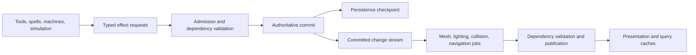

# Project Axiom revision 4: architecture review and refinement

2026-10-24. **Design review only.** No engine changes, dependency upgrades,
builds, tests, benchmarks or game launches in this pass. Proposed contracts below
are not implementation claims or replacements for existing compatibility gates.

Source: [original supplied revision 4](../specs/project-axiom-revision-4.txt),
preserved byte-for-byte; SHA-256
`C705D4443A946E1593F1CBCAD0219EA8734BDD087B09FBC0F1C1320B96E8ACF1`.
This review refines its architectural decisions while retaining its gameplay scope.
Use alongside [the integration guide](../plans/2026-10-24-engine-and-world-refinement.md),
[current architecture](../ARCHITECTURE.md), ADRs 0017–0019 and
[the North Star](NORTH_STAR_UNDERSTAND_BUILD_CARRY.md). It does not reset those plans
or declare their remaining work complete. Source observations describe a dirty,
concurrently changing checkout; recheck before implementation.

## Assessment

Keep the central promise: a persistent world where understanding an interaction
lets the player turn it into a tool, spell, machine or farm. Make computational
cost follow active consequences. The strongest next investment is a reliable
commit-and-publication boundary connecting existing systems, followed by one
complete Observatory route. A new global storage structure is not a prerequisite.

Revision 4 needs six corrections before it is an executable architecture:

| Priority | Gap | Refined decision |
|---|---|---|
| P0 | “Lossless multiscale” conflates storage, rendering and physical models | Separate exact state, derived geometry and explicitly approximate simulation; define admissible conversions |
| P0 | Bounds and a revision do not define a transaction | Specify admission, read dependencies, ownership, atomic commit, failure results and durable recovery |
| P0 | Priorities do not define overload behavior | Bound admission, preserve authoritative order, expose debt and define what happens at capacity |
| P0 | Fallback coverage can preserve obsolete walls or erase openings | Transfer coverage only between compatible artifacts; handle edited geometry separately from missing detail |
| P1 | A common hierarchy is presented as a common connectivity answer | Share spatial indexing; use consumer-specific connectivity and validity |
| P1 | The first playable location depends on almost every future subsystem | Split a complete initial route from pressure, collapse, farming and semiconductor extensions |

## 1. Preserve and extend the implementation already present

These are source findings, not runtime acceptance:

| Area | Current evidence | Consequence for revision 4 |
|---|---|---|
| Spatial layout | `crates/core/src/coords.rs`: 32³ chunks; `crates/sim/src/cell.rs`: 8³ bricks | Benchmark 16³ against 8³; do not silently replace the existing layout |
| Physical scales | `engine_core::VoxelScalePreset`: one 1, 0.5 or 0.25 m scale per world | 12.5 cm and mixed physical scales remain proposals requiring separate storage/solver work |
| World writes | `World::set_many_with` checks ownership/admission per edit; some edits can be skipped | Batching is not an all-or-nothing transaction; introduce explicit outcomes before promising atomic machinery |
| Water and soil | `world/environment` holds exact water deficits, stock ledgers and due events; `geometry.rs` refines soil stocks before edits | Reuse these contracts. Soil aggregation does not establish arbitrary coarse-fluid or terrain equivalence |
| Live simulation | `simulation/fixed.rs` shares per-step driver calls; ADR 0018 isolates the CPU region and suspends unmigrated writers | Keep authority migration explicit; common tick order does not make legacy wall-time scheduling deterministic |
| Mesh publication | `render/streaming.rs` checks job/world/cache identities and local dirty revisions; halo invalidation and edit proxies exist | Audit dependency completeness and publication timing before adding another revision system |
| Factory graphs | `Factory::tick` caches cable, pipe and fluid networks until topology invalidates | The missing step is narrower component invalidation and scheduling, not inventing cached graphs |
| Rigid assemblies | `simulation/rigid.rs` and `sandbox.rs` already represent bounded local voxel bodies and serialize body state | Evaluate an adapter against current behavior; do not create a competing body authority |
| Navigation | `adventure/navigation.rs` has bounded local routes and body sweeps | Preserve local collision checks while adding regional planning selectively |
| Persistence | `world/storage.rs` currently writes version 32; experimental CPU mirrors cannot use ordinary saves | Any future schema change must inspect the live version; this review reserves no version number |
| Optional roguelite | `adventure/resonance.rs` layers temporary boons and banked rewards over permanent worlds | Keep it optional. It does not substitute for environmental interactions or the Observatory slice |

The renderer already has substantial streaming and residency machinery. Treat
revision 4's recommendations as acceptance criteria for that machinery, not proof
that it is absent or defective. No observed frame-rate or visual improvement is
claimed by this audit.

## 2. Define exact authority before choosing representations

Use three independent concepts:

- **Storage encoding:** uniform, palette, dense or procedural-plus-edits. Decode
  must reproduce the same authoritative state at the same content/generator version.
- **Render detail:** an approximation of authoritative geometry. Changing it cannot
  change collision, resources, recipes, visibility used by AI or saved material.
- **Simulation model:** a declared physical approximation with conservation,
  error and activation rules. Changing models is a state transition, not a mesh LOD change.

Preserving mass alone cannot preserve a thin pipe, a sealed chamber and an open
chamber as the same coarse cell. Preserve fine state or a sufficient model-specific
description, and reject aggregation when its prerequisites fail. Refinement may
redistribute conserved totals deterministically, but that does not recover discarded
fine history. Document that distinction instead of promising universal losslessness.

Keep stable integer cell/object identities, explicit physical units and half-open
bounds. Use floor division for negative coordinates. Separate `CellScale`,
`RenderLod` and `SimulationModelId`; avoid one `lod` field controlling all three.
Large-world work needs integer region origins and local floating-point transforms
through queries, saves, collision and rendering, not only camera-relative shaders.
An i64 migration is separate work; the current integer indices are i32.

For mixed geology/construction, define composition before adding an SDF mesher:
generated base → persistent terrain modifications with explicit ownership →
object-local volumes queried through their transforms. Define subtraction,
intersection, mining yield and material ownership consistently. Cosmetic surface
relief cannot create traversable holes or harvestable volume without authoritative
geometry. Do not count overlapping representations as two material inventories.

## 3. The world kernel is a commit boundary

The kernel coordinates commits, clocks, resource ownership and change delivery.
Specialized solvers retain their data structures. It is not a universal solver or
a mandatory entity/component model for every voxel.

Proposed request metadata: world epoch, command ID, simulation tick, source owner,
read-set versions, affected owners, typed operation and explicit resource budget.
Proposed result: accepted/deferred/rejected, committed quantity, reason and commit
ID. Distinguish all-or-nothing transfers from intentionally partial bulk excavation.
Never charge inventory for a rejected effect or report a partially applied batch
as fully committed.

Admission reserves destination storage, event capacity and required refinement
before removing source stock. Validate dependencies again at commit; a changed
read set causes a deterministic retry or explicit rejection. Multi-owner transfers
debit and credit together. Terrain-to-body detachment transfers material, transform,
mass and ownership together; settlement performs the inverse with collision checks.

Emit changes only for committed results. Include category flags, owner identities,
changed bounds and relevant old/new facts or references. Geometry, water quantity,
thermal state, light emission and network topology need distinct categories.
Consumers declare dependency halos; do not assume six adjacent chunks cover every
algorithm. Coalescing notifications may discard redundant rebuilds, not intermediate
material transfers or gameplay events.

Use world/session epoch plus per-owner or per-field versions for cache dependencies.
A global revision is useful for ordering, but unrelated edits should not cancel all
jobs. Validate at final publication, including after staged GPU upload. Generation,
content definitions, neighboring samples and object transforms belong in the read
set when used. Hashes are fingerprints, not replacements for ownership rules.

A bounded change stream needs consumer cursors and a recovery rule: lagging derived
consumers rebuild from a coherent snapshot when history expires. Gameplay events
cannot be silently dropped. Avoid unbounded dependency maps and retained snapshots.

A save captures a coherent committed cut across terrain, machines, bodies and
inventories, plus pending authoritative continuations and logical clocks. Either
complete a cross-owner transfer before that cut or persist its reserved state
exactly once; never save a debit without its credit. Reuse checksummed atomic
publication and versioned migration, then choose between coordinated snapshots
and a bounded transaction journal based on measured write costs. A checkpoint is
durable only after every referenced region is durable. Dirty eviction and recovery
must not fall back to procedural terrain when edited data is missing or unreadable.

## 4. Scheduling must define behavior under pressure

Keep critical, interactive, background and opportunistic classes, but give each
queue a byte limit, work limit, oldest-due age and cancellation policy. Save/flush
and authoritative cross-boundary transfers receive reserved progress; their
priority cannot be reduced by a graphics-quality controller.

Authoritative ordering uses simulation ticks and stable tie-breaks. Work quotas and
continuations are deterministic and persisted where they affect future outcomes.
Wall-clock deadlines may interrupt implementation work; they must not choose a
different committed subset and silently advance the logical clock. Exact snapshots
and approximate background catch-up require separate, declared contracts.

At capacity: reject/defer new expensive actions before charging resources, retain
bounded resumable work, or explicitly slow authoritative time. Do not promise both
unlimited admitted work and guaranteed real-time simulation. Let the UI explain a
blocked machine or overloaded spell. Cosmetic refinement can be dropped.

An island is an ownership-and-time boundary, not merely an AABB. It has member
owners, model/version, next logical tick, boundary ports, pending exchanges and
continuations. Before islands merge, split or sleep, reconcile their logical time
and pending transfers. A projectile wakes the required collision region before
entering it; unknown or unread data is not empty space.

For coupled fine/coarse solvers, accumulate equal-and-opposite boundary fluxes over
the same time interval. Keep integer/remainder ledgers where appropriate. Specify
conserved mass/species, energy assumptions, momentum treatment and explicit magic
sources/sinks. Temperature is not energy; fluid volume is not pressure; electrical
power is not stored charge. Solver substeps follow stability requirements, not
camera distance. Coarse catch-up is permitted only for models with validated rules.

## 5. Coverage, topology and authoritative queries

Track coverage separately from desired detail. A parent retires only when the
required child cover is uploaded and publishable together. Compatible coverage
must survive cancellation, eviction, device loss and failed allocation. Prioritize
filling uncovered regions before refinement.

Keeping an obsolete parent can resurrect a mined wall. A recent edit therefore
needs a compatible local replacement or an edit-aware clipping/masking path; an old
mesh is not automatically a valid fallback. Collision and hit queries use committed
occupancy while visual repair catches up. Define the presentation latency budget,
instrument it and flag temporal-history invalidation on discontinuous replacement.

Non-heightfield landmarks need 3D representatives. A silhouette proxy may preserve
a distant bridge but cannot authorize traversal or fluid connectivity. Specify
which openings/topology a proxy must retain, its error bounds and its fallback
when it cannot satisfy them. A larger AABB or “any solid child” bit is insufficient.

Reuse a spatial index, but keep separate summaries for walkability by body size,
fluid/gas connectivity, acoustics, electrical ports and render occupancy. Their
definitions of “connected” differ. Invalid summaries answer **unknown** and trigger
refinement or bounded local queries. Visual coarsening must never seal a pipe or
invent an AI route. Apply exact local invalidation before propagating summaries.

## 6. One effect vocabulary, several useful disciplines

Start with one shared operation, preferably a finite fluid transfer already close
to existing water/machine behavior. Specify source, destination, quantity, supply,
capacity, geometry revision and partial-transfer semantics. Exercise it through
a handheld action and a pump before expanding to thermal, electrical and force
operations. UI previews read the same rules that execute the operation.

Magic provides portable bursts; machinery provides sustained work and containment;
electronics provides sensing and control; biology provides growth and renewable
processes. Do not make the four interchangeable resource skins. A mounted wand
executes the same effect definition as a held wand, with different supply and duty
cycle. Keep mana, material and thermal conversion explicit.

Preserve the existing wand/deck evaluator and introduce typed effect leaves before
a replacement graph compiler. Bound triggers, queued continuations, targets,
material creation and lifetime. Persist effect ownership and any continuation that
can still change the world. Provide inspectable cost and exhaustion behavior.

Keep factories' existing coarse energy accounting for ordinary production.
Introduce modified nodal analysis only for an electrical circuit subsystem whose
gameplay needs voltage/current behavior. Define power/energy conversion at its ports;
do not solve every cable as an analog circuit by default.

Semiconductor design remains an advanced, separate engineering grid: validated
netlists, process limits and bounded logical execution. Throughput, I/O and heat
follow a declared gameplay model, not an implied transistor-accurate simulator.
Save program/netlist identity, process revision and controller state. Give early
players sensors, timers and useful presets before requiring chip design.

Mod definitions need namespaced stable IDs, schema/content versions, deterministic
load order, validation and save-migration rules. Missing content must not silently
become air. Sandboxed scripts use budgeted commands, not direct world mutation or
per-voxel callbacks. Track budgets per owner/mod as well as per world. Multiplayer
and cross-platform lockstep are future scopes, not assumed consequences of Rust.

## 7. The Observatory is a sequence of complete playable increments

Use **Flooded Observatory** as the existing canonical project name; “Drowned
Observatory” in revision 4 describes the same acceptance location. Avoid a second
unrelated dungeon or a requirement to finish all engine research first.

| Increment | Playable result | Exit evidence required later |
|---|---|---|
| O1: access and recovery | A finite flooded gallery, recognizable objective, useful recovery reward; a dug drainage route and a powered pump route with different costs | Both routes alter the same stored water; destination capacity matters; leave/reload preserves edits and recovered state |
| O2: portable intervention | A spell uses the same admitted transfer operation; inspectable material and supply cost | Manual, machine and spell paths obey identical ownership/conservation constraints |
| O3: guardian and reuse | Existing guardian behavior responds to one real environmental condition; facility remains useful afterward | Environmental intervention changes an observable encounter outcome; reward settles once; no hidden route-specific completion switch |
| O4: deeper engineering | Validated pressure/structural failure, repeatable ecological production, controllers and more complex automation | Each extension passes its own conservation, persistence, workload and gameplay gates |

O1 contains a finite, auditable reservoir; it does not promise a full regional river
solver. O3 is not a checklist of every boss weakness. Farming remains valid ordinary
gameplay, while the optional resonance reward ledger can exclude farm-produced
kills to prevent a separate expedition reward loop. Never remove persistent builds
as an ordinary roguelite reset.

## 8. Art, animation and feedback are architectural consumers

Retain readable block construction, irregular geology and the existing restrained
copper/gold, mineral-teal and fungal material language. Surface detail should explain
material and wear. Lighting must distinguish traversable openings, hazards and
machines without concealing coverage failures in fog or bloom.

Animation reads authoritative mechanisms and combat phase: pump motion follows
delivered flow, conveyors follow item movement, boss tells match attack timing.
Render interpolation may smooth motion but cannot decide hits or manufacture output.
Maintain previous transforms for moving objects; invalidate history when fracture,
teleportation or LOD replacement breaks correspondence. Budget decorative particles
separately from simulated matter.

Preserve the detailed pixel-font direction through actual TrueType font rendering,
with readable body text and fallback glyphs. Use compact contextual inspection for
flow, power, heat, spell order and failures; show information at the point of a
decision. Graphics quality may simplify decoration, not remove these cues.

## 9. Research findings and dependency policy

Checked against primary sources on 2026-10-24, after Context7 lookup for library
questions. These findings authorize no package change:

- **wgpu:** the pinned [30.0.1 feature documentation](https://docs.rs/wgpu/30.0.1/wgpu/struct.Features.html)
  exists and lists optional indirect-count drawing and experimental mesh/ray
  features. The app currently requests 27.0.1. Keep that baseline until a separately
  measured migration justifies its integration cost; feature availability is not
  adapter/backend portability or a performance result.
- **Rapier:** official [voxel shape documentation](https://docs.rs/rapier3d/latest/rapier3d/geometry/struct.Voxels.html)
  exposes voxel construction/editing operations. This does not implement fracture,
  support analysis or the world's ownership handoff. Compare voxel and compound
  colliders on moving assemblies, including contact updates, rebuild latency and
  mass-property handling. Keep application save state independent of opaque backend handles.
- **NanoVDB:** the [NVIDIA publication page](https://research.nvidia.com/labs/prl/publication/sifakis2026dynamic/)
  is dated **December 2026**, later than this October review. Treat the visible
  description as future-dated research; do not assert its published availability
  or maturity as of October. Compact active-voxel iteration remains a useful
  experiment independent of adopting this implementation. Include topology updates,
  halos, transfers, synchronization and memory in comparison costs.
- **Binary greedy meshing:** the [author's repository](https://github.com/cgerikj/binary-greedy-meshing)
  describes eight-byte quads and timings for its own workload. That encoding does
  not include every feature this renderer may need. Compare material/AO constraints,
  transparency, edits, upload size and rendering together. Its screen-space crack
  concealment is not proof of watertight physical geometry.

Keep conventional rasterization with capability-checked fallbacks as production
policy. Choose algorithms through isolated experiments; do not bundle a wgpu
upgrade, new mesher, storage rewrite and physics replacement into one milestone.

## 10. Refined sequence and acceptance

| Gate | Scope | Evidence before expanding |
|---|---|---|
| A: trustworthy baseline | Freeze attributable builds/configurations; use existing profiler and capture routes | Normal exploration, excavation and teleport routes show coverage and timing together |
| B: commit/publication contracts | Audit one edit and one transfer end to end; unify outcomes and dependencies without replacing all storage | Boundary edits, rejected admission, stale jobs and save/reload behave consistently |
| C: first shared effect and O1 | One finite transfer path, existing pump integration, two playable access routes | Conservation and distinct routes work in a persistent site |
| D: O2/O3 | Spell source, one environmental boss interaction, useful permanent facility | Complete exploration-to-engineering loop in ordinary play |
| E: scale proven systems | Component-level network scheduling, background models, selected body/navigation improvements | Bounded backlog, defined sleep/wake behavior and long-session continuity |
| F: research-led expansion | Mixed physical scales, advanced circuits/fab, broader ecosystems and mod behavior | Explicit error/conservation contracts plus measured workload and content value |

Art and usability progress with every gate. Do not require mixed-resolution physics,
analog electronics or new rigid-body middleware before C. Defer content breadth
before weakening persistence or authoritative interaction. These are gates, not
calendar commitments.

Keep the existing low-end target alongside the aspirational RTX 4090 profile.
Define separate resolution, visual budgets and workloads. A 4090 result cannot
prove Iris Xe acceptance. Comparable workload means the same world operations and
resource outcomes; it need not mean identical decorative quality.

For the proposed desktop target, report frame p95 against 8.33 ms for normal play
and 16.67 ms for a specified stress workload, with p99/max separately. Also record
simulation lag, command-to-commit latency, commit-to-visible latency, backlog age,
resident/peak memory, upload bytes and queue saturation. These are proposed targets,
not measurements. Correctness and visual gates remain independent vetoes: faster
frames achieved by dropping edits, freezing factories or missing terrain fail.

Future validation includes interrupted saves and ownership transfers, negative and
cross-chunk coordinates, lossless storage round trips, conservative model exchanges,
stale cache publication, active-set scaling, near/far motion captures and a complete
Observatory playthrough. These checks are specified here, **not added or executed**.
Existing user instructions still govern when tests and runtime evaluation occur.

Recommended next implementation scope: **Gate B, one terrain edit and one finite
fluid transfer**, using existing world/environment and renderer paths. It closes
the key architectural gap without creating a second engine beside the game.
