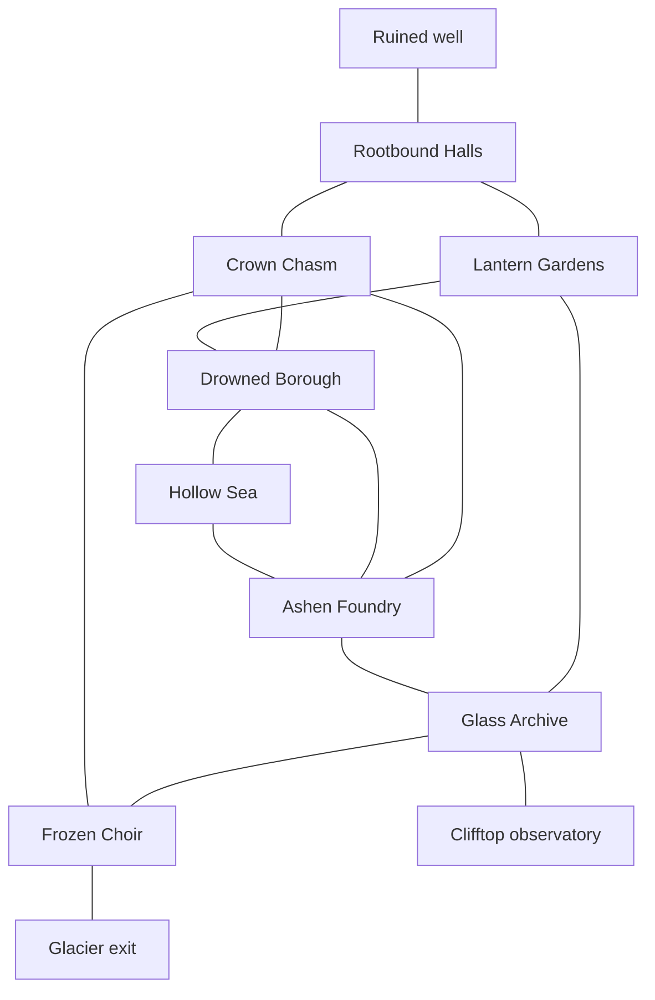

The Undercrown is a proposed underground region for the voxel adventure: a connected buried landscape of inhabited bridges, flooded streets, root temples, furnaces, archives, ice caverns, and a deep inland sea. Its central promise is that exploration gives the player new powers, useful knowledge, memorable relationships, and lasting changes to the world.

A successful expedition should end with the player understanding something they only glimpsed on the way down, reaching a meaningful destination, and choosing an unresolved lead for a later visit. The journey below is one possible expedition through an open network. Other approaches should support equally complete stories.

All room names, scenarios, items, and design targets below are original proposals. The design references support selected principles; the proposed content still needs playtesting.

# The journey from descent to daylight

## An entrance that invites investigation

A ruined roadside well exhales warm air. Far below, a blue lamp moves sideways. Water drips down the shaft, but the echo comes back from somewhere much larger than a well.

The player can descend by the old maintenance ladder, secure a rope, or investigate the collapsed pump house and find a sloping access passage. They can see the first landing before committing. The entrance promises scale, inhabitants, and a route home.

At the landing is a small shrine, a broken freight counterweight, footprints, and an inscription that reads, “For those who carry the burden, the road descends.” A suspended crate demonstrates the counterweight’s function. Moving ballast lowers a platform; a rope or a supported climb also works. The room quietly teaches that an object’s function matters.

## An early reward that immediately changes play

The first optional treasure is the Counterweight Ring. It lets the player transfer some effective weight between two marked movable objects while maintaining the aura; it does not erase mass or create unlimited energy. A small balancing beam beside the cache demonstrates its rules safely.

Minutes later a broken stair can be crossed by lowering a freight platform, using the ring with a nearby ballast, building a short bridge, or taking an inhabited service corridor. The ring has already become a tool the player wants to keep.

The early reward should be useful on the expedition where it is found. Give the player a small safe experiment before asking them to use it under pressure.

## A glimpse of the destination

The narrow passage opens into the Crown Chasm: an enormous fault containing cliff streets, waterfalls, hanging buildings, and the remains of a colossal bridge. Across it hangs a bronze bell larger than a house. On an upper ledge, a white observatory catches a thin shaft of sunlight.

The player can see reachable terrain around the bell, small figures moving beneath it, and an inaccessible doorway above the far waterfall. These are real destinations in the traversable world. The player can reach the top, underside, interior, and approaches of the major landmarks.

Three nearby routes offer different promises: warm bread smells from the bridge settlement; green spores drift from a garden tunnel; a chain lift descends toward flooded rooftops. Each direction advertises something useful without revealing every outcome.

## A strange room that rewards understanding

The Hall of Patient Bells contains a floor suspended on chains. Crossing too heavily raises alarm bells and tips the floor toward a lower chamber. Scuffed tiles, visible chains, a trapped wheelbarrow, and a hanging inspection diagram explain the mechanism.

The player can redistribute ballast, bind the floor to an anchor, carefully cross its supported edge, silence the bells and accept the movement, or open the service hatch. Falling leads to the lower maintenance route with a visible way out; optional treasure hangs above a separately marked deeper hazard.

The reward is Bellkeeper’s Gloves, which absorb part of a successfully braced impact as stored mechanical energy and later release a bounded shove. The reward is also knowledge: this culture operated much of its infrastructure through tension, weight, and resonance.

## People make the underground feel inhabited

Houses occupy the underside of the broken bridge. There are patched windows, a kitchen, a repair stall, a little shrine made from climbing gear, and children using a freight pulley as a toy. The settlement is visible before any hostility begins.

The residents need their water lift repaired. A ferryman wants a current chart. A salvager will exchange a relic clue for news about a missing partner. Trade, theft, intimidation, repair, and cooperation have understandable local consequences.

The player earns a bed, a place to deposit treasure, and a useful rumor by helping. A return route opens to the first landing. They can finish a satisfying short expedition here or continue toward the bell.

## A new biome changes the available ideas

Below the settlement lies the Drowned Borough. Streets run beneath clear water; balconies function as docks; great air bells make islands of dry space. Roof routes, ferries, maintenance ducts, and diving approaches overlap.

A vault is visible through a flooded courthouse. The player may enter through the roof, use an air pocket, bargain for a diving bell, or repair a bypass and lower the local water. The control station physically shows the receiving basin and its settlement. Inhabitants explain why an uncontrolled release would hurt them.

Repairing the bypass opens the vault while keeping the settlement’s supply. Taking a faster drawdown exposes other streets but temporarily closes a ferry route. The player changes a shared place and can inspect the consequences.

## A relic lets the player make a plan

Inside the courthouse is Rimeglass Buckler. It retains a limited cold charge, replenished by Rime or sustained contact with a cold source, and releases it immediately through shield contact. A broken ice sculpture and a maintenance basin give the player a safe demonstration.

Back at a broken aqueduct above the chasm, they freeze water into a floating panel, bind it to sound anchors, then use Impulse to position it across a short break. The panel rests on surviving supports or remains properly rigged; the ice itself does not hover. Another player could repair the cable cradle, persuade the bridge workers to lower a gantry, climb the piers, or take the longer garden route. Advanced movement may bypass the crossing entirely.

The game recognizes arrival, recovered objects, and changed machinery. It does not require the player to solve the crossing through a particular scripted sequence.

## The landmark becomes something the player understands

The immense bell is part of the old freight and warning network. Reaching it reveals a sleeping maintenance guardian jammed by damaged equipment. Its behavior can be understood by observing which sound and machinery states disturb it.

The player can repair the cradle, redirect the bell’s resonance, bargain with a caretaker, sneak through the interior, steal the optional relic, or fight. Defeating it is one resolution. Restoring the bell reconnects lifts in several regions and produces a sound the player can hear from places already visited.

This is the expedition’s major payoff: a strange object glimpsed earlier has become a tool, a place, and a story.

## An exit that changes the surface

The restored service route climbs into the observatory. Along the ascent, windows frame the bridge from above and show the courthouse whose roof the player crossed. A broken wall gives one last view of an unvisited district.

The player emerges through the observatory’s upper door onto a cliff on the other side of the mountain. Below is the road they knew from the surface. If they restored the observatory lens, its beacon is now visible from that road. If they left by a different route, the endpoint is still distinctive: behind a waterfall, inside an abandoned watchtower, or beside a glacier.

They return carrying a useful power and several specific unfinished questions: the door above the waterfall, the singing ice, the barge that vanished beneath the city. The exit completes one expedition and gives the next one a direction.

# The region as a connected place

Start with geology and former purpose. A tectonic fault exposed deep caverns; an older civilization built water, freight, and light infrastructure through them; later cultures occupied different parts. Gardens feed on warm outflow, the foundry depends on water cooling, the archive exploits stable dry air, and the frozen district sits beyond a cold magical fault.

These dependencies make transitions physical. The player follows a canal, exhaust duct, root, crystal vein, or railway into another district. Changes to one system can create routes or opportunities in another.

| District | Spatial and architectural identity | What changes the play |
| - | - | - |
| Rootbound Halls | Burial chambers split by roots, collapsed courtyards, hollow trees, old prison galleries | Grow supports, investigate former inhabitants, follow water and root networks |
| Crown Chasm | Cliff settlements, suspension bridges, giant stairs, freight cranes, hanging temples | Vertical routes, wind, load-bearing machinery, long views and crossings |
| Drowned Borough | Roof streets, flooded courts, canal markets, diving bells, aqueducts | Water level, buoyancy, air pockets, ferry access and submerged treasure |
| Lantern Gardens | Fungal forests, irrigation terraces, insect nests, living halls | Light and heat attract life; growth creates routes; spores reveal airflow |
| Ashen Foundry | Casting pits, cooling canals, rail yards, workers’ quarters, slag bridges | Heat, pressure, movable machinery, fabrication and freight transport |
| Glass Archive | Crystal stacks, light galleries, sealed reading rooms, resonant bridges | Reflection, stored sound, brittle material, information and magical experiments |
| Frozen Choir | Buried palaces, ice organs, frozen waterfalls, air tunnels | Insulation, thawing, brittle ice, wind, resonance and preserved history |
| Hollow Sea | Beaches, fossil cliffs, wrecks, tidal temples, submerged towers | Boats, currents, huge creatures, tides, deep routes and late exploration |

## Connections that create choices

Give the player a public route, an improvised route, and a surprising connection wherever the district’s function supports them. Their costs should differ. A ferry is safe but follows a schedule; a maintenance ledge is fast and exposed; a submerged passage uses breath or equipment; a repaired lift becomes a lasting convenience.

At the region scale, connect districts into several overlapping loops. Within a district, routes wrap around its landmark and cross different elevations. Within a room, furniture, machinery, stairs, balconies, and breaches support tactical alternatives.

Some entrances should begin halfway into the network. A glacier cave, a dry storm drain, and a ruined well can place the player in very different starting situations. Some deep routes should skip intervening districts.

A secret may reveal the far side of a familiar room, a safer approach to an enemy, a route to another biome, or a spectacular viewpoint. Treasure is only one kind of secret reward.

Justin Alexander’s discussion of nonlinear dungeons explains how loops, multiple entrances, and several connections between levels support alternative routes and exploration. The Undercrown applies those ideas to a persistent, changeable three-dimensional region. [Design reference](https://thealexandrian.net/wordpress/13103/roleplaying-games/xandering-the-dungeon-part-2-xandering-techniques).

## Regional connection sketch

This sketch shows potential connections, not physical elevations or scale. Individual routes have observable access conditions, and some become convenient only after local changes.

## Architectural variety with continuity

Use a small number of cultural construction languages deeply. Canal builders use hydraulic counters and patterned ceramic pipes. Cliff masons use suspended loads and monumental anchors. Root keepers graft living architecture around existing stone. Archive builders use glass, shutters, sound, and removable panels.

Show kitchens, latrines, barracks, nurseries, loading bays, storerooms, repair platforms, and gardens alongside temples and vaults. Each culture’s practical spaces teach the same material rules used in its dangerous rooms.

A district’s original purpose, later damage, and present occupation can overlap. A chapel becomes a greenhouse, then a refuge; a prison becomes an orchard; a freight bridge becomes a settlement. That history changes geometry and use, rather than appearing only in written lore.

Large caverns need reachable layers. Build the floor, walls, ledges, suspended structures, roof routes, and connecting shafts as parts of the same place. A landmark should make a player ask how to reach another visible part of it.

# Rooms that create stories

Every substantial room needs a recognizable premise, an observable situation, something the player can try, and a worthwhile consequence. The table is an original catalogue for the region; it is a content pool, not a requirement to place every entry on every expedition.

Crossing a room and taking its best treasure should often be different challenges. A player can continue exploring while leaving a difficult optional reward for another visit.

## Rootbound Halls

| Room | Play and reward |
| - | - |
| The Chapel Growing Through the Prison | Roots open some cells while holding up the ceiling. Learn who still wants protection, brace a new passage, or use an existing crawl route. The former evidence room holds confiscated equipment; its drains lead toward the city. |
| The Orchard of Remembered Hands | Trees respond to familiar scents, demonstrated by abandoned gloves and tagged branches. Recreate a scent, bargain with keepers, or use canopy walks. Choose powerful fruit and grafting stock; irrigation returns to the bridge village. |
| The Root That Holds the Ceiling | A treasure chest is caught behind a living support. Brace the roof, move the chest through another opening, or grow a substitute root before cutting. The altered support exposes a high route into the gardens. |
| The Pilgrims’ Kitchen | A cooking hearth drives a dumbwaiter and warms a sealed wall. Cook, repair the mechanism, or reach the store from its service stair. Food and a useful recipe come with a quiet rest spot. |
| The Tomb Facing the Wrong Way | Adjacent tombs all orient toward a sound shaft, except one. Following construction joints or comparing inscriptions reveals a later alteration. The reward is access to a forgotten listening gallery. |
| The Borrowed Grave | A living resident sleeps in an abandoned sarcophagus and has legitimate salvage papers. Negotiate, verify their story, or leave peacefully. Their maps identify another surface entrance. |
| The Door Behind the First Camp | From deep in the roots, the player recognizes the back of an entrance-side structure. Release its counterweight, clear a supported obstruction, or ask earlier allies for help. A long journey becomes a short permanent connection. |
| The Nursery Beneath the Mausoleum | Pollinators inhabit warm burial niches. Protect them, divert them with scent, or pass by another level. Their wax supports equipment crafting; the vents reach the fungal forest. |

## Crown Chasm

| Room | Play and reward |
| - | - |
| The Bridge That Became a Village | Houses hang beneath a broken bridge. Cross through public walkways, repair the freight cradle, or use maintenance cables. Earn a bed, trade access, and the city’s water lift. |
| The Auction of Unclaimed Baggage | Porters sell recognizable expedition packs. Bid, trade work, or find a living owner and negotiate. A recovered survey instrument points into the archive. |
| The Giant’s Listening Stair | Footsteps carry through a hollow statue toward a sleeping predator. Muffle the route, lure it elsewhere, or use the statue’s exterior ladders. A shield waits in the head; its mouth overlooks the ice district. |
| The Balcony Beyond the Map | Footprints disappear over a parapet while lanterns signal across the gulf. Inspect the exterior stair, answer the signal, or build a crossing. The balcony joins the root cathedral. |
| The Hall of Patient Bells | A suspended floor shifts with weight. Redistribute ballast, anchor it, use its edge, or take the maintenance hatch. Recover an impulse-storing tool and learn the local machinery. |
| The Freight Cradle Over Nothing | A loaded cradle has a broken receiving platform. Unload ballast, reconnect a support, or transfer cargo by rope. Restoring it opens a regional transport route. |
| The Stone Giant’s Pocket | A carved figure contains a reachable ledge visible only from below. Climb scaffolding, approach from its shoulder, or use an advanced traversal power. Inside are personal letters and a distinctive piece of equipment. |
| The Bellkeeper’s Crown | A giant warning bell and maintenance guardian control connected lifts. Repair, redirect, negotiate, evade, steal, or fight. The outcome changes travel across several districts. |

## Drowned Borough

| Room | Play and reward |
| - | - |
| The Street Beneath the Air Bell | An enormous trapped-air chamber creates a dry neighborhood below the waterline. Arrive by ferry, dive between air pockets, or repair its access shaft. A jeweler’s upper balcony holds an optional cache. |
| The Court of Floating Witnesses | A salvage court drifts between competing ropes. Present evidence, mediate, or recover the disputed cargo. Trading rights and a new docking route are the rewards. |
| The Reservoir With Two Names | One shore treats the water as a supply, the other as a burial place. Dive, repair a bypass, or negotiate a measured drawdown. The vault and its local consequences are visible before the choice. |
| The Bell Where Something Breathes | A diving bell rises over an amphibian’s nest. Wait for its hunting circuit, redirect it with food, or use the separate shaft. Survey tools and a deep garden route await. |
| The Flooded Courthouse | A relic vault is accessible from roofs, water, or controlled drainage. The nearby receiving basin makes water decisions understandable. Recover Rimeglass Buckler. |
| The Bathhouse of Reverse Flow | Some pools empty while others fill because a service pump is misrouted. Read flow marks, isolate a valve, or traverse the upper gallery. A cleaned pool reveals a merchant’s sealed travelling chest. |
| The Fish Behind the Window | A large fish carries a swallowed signet visible through a pressure window. Bait it toward an accessible pool, bargain with its keeper, or recover a different proof of ownership. The signet grants access, not the only exit. |
| The Aqueduct Inside a House | A later building wraps around an older water channel. Follow the channel, inspect service walls, or access the roof. The discovery joins apparently separate neighborhoods. |

## Lantern Gardens

| Room | Play and reward |
| - | - |
| The Garden That Eats Fire | Fungal sails bend toward heat, demonstrated by workers’ caged lamps. Apply heat deliberately, carry cold light, or follow a gardener. Harvest fire-resistant fabric; the exhaust reaches the foundry. |
| The Archive of Borrowed Voices | Fungi replay nearby sounds, mixing old calls with a real distress signal. Send a recognizable reply, triangulate the changing response, or follow physical tracks. Rescue earns records and a route into frozen masonry. |
| The Feast Before Migration | Scavenger families gather before a seasonal move. Contribute food, solve a practical dispute, or trade stories. Introductions, treasure leads, and convoy routes follow. |
| The Sleeping Giant Beneath the Orchard | Roots outline a breathing creature. Follow its movements, guide growth away from it, or use an upper route. A fallen expedition cache lies near its nest; waking it changes local pathways. |
| The Pollinator’s Toll | Insects gather only around a particular resin. Find a substitute, carry the resin away, or protect the keeper’s crop. Wax and a safe crossing become available. |
| The Seed Bank in the Dry Room | A sealed store lacks the moisture needed for its living lock. Restore its feed line, cultivate another opening, or enter through service masonry. Rare seeds expand Bloom’s applications. |
| The Root Bridge That Drinks the River | The bridge’s strength depends on an obvious feeder channel. Restore the flow, brace the span, or cross on a different layer. Its restoration links garden settlements. |
| The Lantern Orchard | Hanging luminous fruit can guide travelers or feed nocturnal animals. Harvest selectively, learn cultivation, or trade with caretakers. Keep a renewable light source and a useful local relationship. |

## Ashen Foundry

| Room | Play and reward |
| - | - |
| The Foundry That Still Has Orders | Constructs manufacture parts for a vanished bridge. Submit a compatible order, provide materials, or redirect a finished part. Restore a crossing or commission a tool. |
| The Last Slag Train | A freight train creeps toward damaged track. Divert it, unload it enough for its brake, or repair the gap. Salvage and transport follow; failure changes the ravine below. |
| The Furnace With a Cold Heart | A cooling blockage sends heat into occupied rooms. Clear the channel, reroute flow, or isolate the furnace. Repair earns access to the workers’ old cache. |
| The Mold of an Unknown Weapon | A partly completed casting suggests a forgotten tool. Compare its instruction plate, ask a smith, or experiment with a cheap sample. The finished item can solve practical problems elsewhere. |
| The Counterweight Chapel | Worshippers decorated an industrial lift with offerings whose weight matters. Ask permission to rebalance, add ballast, or enter the machinery below. Restore access without treating every valuable object as disposable loot. |
| The Bridge Cast in a Single Pour | A broken mold spans a service ravine. Repair it and supply material, assemble existing segments, or use a lower route. Casting produces a durable player-made connection. |
| The Vent With Someone Knocking | A worker is separated by hot airflow and a jammed service door. Cool, redirect, communicate, or approach through the duct network. Their knowledge exposes a workshop shortcut. |
| The Workers’ Pool | A warm reservoir forms a refuge between industrial hazards. Rest, meet travelers, and test heat equipment safely. A maintenance mural gives an accurate route to the archive. |

## Glass Archive

| Room | Play and reward |
| - | - |
| The Gallery of Stored Sunsets | Adjustable glass panels release stored light; scorched fixtures reveal dangerous paths. Use shutters, cover panels, or cross shaded service routes. Optional illumination reveals a treasury. |
| The Library With Missing Shadows | Some display cases cast no shadow because a projection masks an alcove. Change illumination, view from another level, or inspect dust and joints. Find a collection of reusable spell modifiers. |
| The Museum of Captured Weather | Sealed devices contain mist, wind, and harmless demonstration storms. Read labels, repair containment, or redirect a selected sample. Take a weather vessel with a defined capacity. |
| The Staircase Heard Through the Wall | Footsteps reveal a neighboring resonant chamber. Use Resonance, compare an old plan, or follow its maintenance feed. The passage connects the archive’s two floors. |
| The Mirror That Shows the Door’s Far Side | A working observation instrument looks into an adjoining room. Learn its physical relationship, communicate through a service opening, or approach from the other side. Information reveals a route without requiring a unique magic key. |
| The Ink River | A broken archival reservoir stains water and reveals currents. Follow the dye, restore the valve, or reach the record racks overhead. Recover maps and reopen a canal connection. |
| The Exhibition That Rearranges Itself | Mechanical display carriages follow a visible cycle. Stop the drive, ride a carriage safely, or use service aisles. Reach a balcony and a rare focus. |
| The Room of Unfinished Maps | Several truthful maps show different periods of the same district. Align surviving landmarks to infer a sealed route. The reward is geographical understanding and a shortcut. |

## Frozen Choir

| Room | Play and reward |
| - | - |
| The Waterfall Hanging Over Dinner | A banquet hall survives beneath frozen water. Cross through insulated kitchens, brace the route, or thaw a small side channel. Preserve food and retrieve a ceremonial vessel. |
| The Ravine With a Moving Bridge | A broad-backed creature follows a visible feeding circuit. Befriend it, repair the footbridge, or use marked ice ledges. Cooperation creates lasting transport. |
| The Organ That Keeps the Doors Warm | A wind-driven organ maintains a refuge. Repair its valve, redirect airflow, or negotiate a temporary shutdown. Earn shelter and access to warm ducts. |
| The Soldier in the Clear Ice | A trapped traveler remains alive through a known preservation charm. Thaw carefully, detach and move the ice, or bring help. Rescue gives testimony and a connection to another faction. |
| The Stair That Melts Behind You | Heated railings gradually melt nearby steps. Isolate the feed, stabilize the steps, or take the maintenance ladder. Warning cracks and an escape ledge keep the challenge readable. |
| The Snow in a Sealed Room | Snow enters through an unexpected cold-air path. Track its drift, use a lamp to show the current, or inspect the roof. Find a glacier exit. |
| The Choir Without Singers | Air and ice reproduce a musical pattern. Learn the visual rhythm, tune a resonator, or open an alternate service route. Recover a resonance perk and a route toward the chasm. |
| The Frozen Market at Noon | Ice preserves stalls and unfinished trades. Investigate, negotiate salvage rights, or assist a surviving caretaker. The best reward is an unusual tool with a clear original use. |

## Hollow Sea

| Room | Play and reward |
| - | - |
| The Lighthouse Beneath the Mountain | A beacon guides boats across a roofed sea. Repair fuel delivery, restore its lens, or install another lawful light source. It reveals islands and changes local navigation. |
| The Wreck Above the Tide | A ship hangs in fossil ribs. Climb the ribs, approach its deck at higher water, or use freight rigging. A captain’s instrument provides a new navigation ability. |
| The Temple That Surfaces | Predictable water movement exposes different entrances. Study water marks, use a boat, or enter by a high maintenance shaft. Each state offers a different optional treasure route. |
| The Beach of Glass Footprints | A creature’s passage leaves vitrified tracks. Observe from safety, follow a cool trail, or ask a local hunter. Discover a crafting material and its source. |
| The Door in the Whale Bone | Later masonry uses an enormous fossil as its frame. Read the excavators’ marks, move a supported panel, or enter through the exposed ribs. The route returns toward the foundry. |
| The Ferryman’s Other Shore | A ferryman wants help with an actual navigation problem. Map the current, repair a marker, or chart another landing. The reward is a new reliable regional crossing. |
| The Air Pocket With a Campfire | A dry cavern beyond a submerged approach contains a genuine refuge. Meet another expedition and exchange discoveries. Its chimney offers a difficult surface route. |
| The Observatory’s Lower Lens | A mirror station projects the surface sky into the cavern. Repair its alignment, approach through the service tower, or bargain with its keeper. The connected ascent ends at a memorable surface overlook. |

# Difficult traps and puzzles with fair rules

Difficulty should come from understanding a situation, choosing a plan, and carrying it out under readable pressure. A player who observes and experiments should be able to succeed on the first attempt. Knowledge from a previous death must not be required.

Teach a mechanism in a safe or already-triggered form, vary it in an optional encounter, then combine it with another familiar system. Put clues where the player can actually perceive them, using more than one channel for essential information: sound plus movement, marks plus a diagram, or an inscription plus a demonstration.

Use graded outcomes. A trap may make noise, separate approaches, move cargo, flood a low route, reveal a lower chamber, or create an enemy advantage. Lethal hazards still belong in dangerous optional spaces, with proportionate warning and a chance to withdraw. Mandatory travel can also be dangerous when the stakes and supported responses are readable.

Meaningful local failure is allowed. A player may knowingly lose an agreement, destroy a valuable relic, or miss a rescue. Record and acknowledge that result while preserving an intelligible route forward and other worthwhile opportunities. Recoverability applies to the continuing adventure; it does not guarantee success in every local objective.

D&D’s official adventure-design guidance recommends varied trap consequences and puzzles with degrees of success rather than mandatory pass/fail bottlenecks. [Design reference](https://www.dndbeyond.com/posts/735-lets-design-an-adventure-monsters-traps-and-other).

| Hazard | Evidence before commitment | Ways to engage and recover |
| - | - | - |
| Suspended weighted floor | Visible chains, wear, a demonstration load, movement under small objects | Rebalance, anchor, use the edge, trigger remotely, or take the lower maintenance path |
| Steam pressure chamber | Rising gauge, hissing pipes, heat shimmer, an accessible relief valve | Vent, cool, reroute, shelter in service alcoves, or leave before the cycle peaks |
| Crystal alarm bridge | A small creature makes the crystals vibrate; sentries visibly respond | Dampen, move quietly, create a distraction, disable a physical resonator, or accept the alert |
| Sweeping light gallery | Scorched tracks and visible shutter movement | Time movement, cover the source, reposition mirrors, use shaded passages, or exploit the beam |
| Sluice surge | Water marks, a changing gate indicator, audible pressure build | Open relief, use high walkways, brace a crossing, or ride a prepared floating platform |
| Rolling freight trap | Sloped rails, a loaded trolley, an obvious release linkage | Brake, divert, jam, trigger early, or aim the trolley at an obstacle |
| Mana-hungry ward | A harmless test cast visibly feeds it; its growth and connections are observable | Break its feeder, use mundane tools, overload within a stated capacity, or bypass its boundary |
| Pit with unstable cover | Sagging surface, support marks, dropped stones revealing depth and water | Bridge, climb, secure a rope, inspect from another level, or accept a prepared descent |

Secrets need consistent evidence too: drafts, tracks, mismatched construction, sound, light leakage, an interrupted pattern, or an informed rumor. An optional inspection action reports physical observations. It should not require pressing a search button on every ordinary wall.

A failed idea should usually produce informative feedback. A root fails because the stone is smooth and dry; a tether strains because the anchor is rotten; a freezing attempt fails because a hot inlet is replacing the water. Make those reasons perceptible.

Puzzles belong to the place. Daily-use machinery has practical controls and service access. A ceremonial trial can be deliberately cryptic. A strange entity may offer a riddle, but the player should understand its stakes and be able to leave or pursue another approach.

Graham Nelson’s puzzle-design chapter argues for consistent world logic, reusable utility objects, meaningful alternate solutions, and avoiding required obscure phrasing or arbitrary item chores. The Undercrown uses those principles for physical interaction rather than a text parser. [Design reference](https://inform-fiction.org/manual/html/s50.html).

Provide optional escalating hints through a journal: first repeat an observed clue, then suggest a relevant property, then explain an approach. Show rhythm and resonance visually as well as audibly. Offer alternatives to rapid timing where the interesting challenge is deduction.

# Magic that keeps expanding exploration

Build the basic vocabulary around six reliable verbs. Their consequences apply to the world, equipment, enemies, and mechanisms wherever the relevant properties exist. A crystal lift responds to vibration because it uses vibrational energy; its counterweight and service drive offer other approaches.

| Spell | Rule | Useful applications |
| - | - | - |
| Kindle | Adds heat with bounded power and range | Light fuel, thaw machinery, heat water, expose heat-reactive growth, threaten combustible targets |
| Rime | Removes heat with bounded power and range | Freeze suitable water, cool surfaces, slow hot mechanisms, create slippery terrain or brittle ice |
| Impulse | Applies directed force | Move loose objects, swing loads, deflect light projectiles, disturb balance, move air and suspended particles |
| Bind | Connects two valid anchors with a visible tension-bearing tether | Rig crossings, retrieve objects, brace machinery, restrain movement, transfer a load |
| Resonate | Injects vibration into a target or the air | Reveal hollows, activate resonant mechanisms, lure listening creatures, stress brittle objects |
| Bloom | Grows roots or carried seed using suitable moisture and support | Create handholds, brace structures, grip objects, entangle targets, feed or redirect local life |

Baseline travel tools should remain useful beside magic: rope, pick, wedges, a lantern, a pole, thrown stones, and ordinary movable objects. Required travel must not depend on retaining one rare consumable or finding one specific equipment drop.

## Equipment and enchantments

Equipment changes an action. An aura changes a selected target. A placed enchantment changes a bounded shared space. Perks change a dependable rule of the player’s existing kit.

Magic’s transferable Equipment, target-altering Auras, and rule-changing enchantments provide useful precedents for these distinctions. The original designs below translate those ideas into physical exploration. [Equipment reference](https://magic.wizards.com/en/news/feature/mirrodin-theme-decks-2008-08-18-0), [Aura reference](https://magic.wizards.com/en/news/making-magic/know-how-part-1-2010-07-12), [Enchantment reference](https://magic.wizards.com/en/news/feature/world-enchantments-2007-06-28).

| Treasure | Form | One memorable rule |
| - | - | - |
| Counterweight Ring | Equipment | Maintains a weight-transfer aura between two marked movable bodies within a load limit. It changes gravitational load; inertia remains. Lifting spends power that cannot be fully recovered. |
| Pilgrim’s Hook-Spear | Equipment | Can be thrown, lodged, retrieved, or used as a lever. A connected physical tether lets touch spells originate at its tip. |
| Bellkeeper’s Gloves | Equipment | Absorb part of a successfully braced impact as mechanical energy, then release a deliberate bounded shove. Charge decays; output respects target inertia and limits on energy, impulse, and speed. |
| Rimeglass Buckler | Equipment | Recharge with Rime or sustained contact with a cold source, then release stored cooling immediately through shield contact. Useful on wet targets, machinery, and prepared water. |
| Mothmantle | Equipment | Opens into a canopy that catches airflow, enabling gliding, controlled descent, and travel on sufficient updrafts. |
| Dewheart Flask | Equipment | Slowly gathers local moisture and pours a controlled stream. Its volume is finite and visible. |
| Echo Lantern | Equipment | Records one nearby sound and repeats it from its current position, including after being placed or thrown. |
| Bellskin | Aura | Makes one target strongly resonant, allowing vibration to travel through supported physical connections and making impacts conspicuously noisy. |
| Glassheart | Aura | Makes a compatible target brittle, increasing its vulnerability to impact and vibration. It can help break armor, a grate, or a tool. |
| Rootbound Promise | Aura | Coats a target in dormant rootlets that moisture and Bloom can grow into nearby rough surfaces. |
| Gentle Rain | Enchantment | Creates a bounded region of falling water that wets everyone and everything within it. |
| Draft of the Deep | Enchantment | Establishes directional airflow in a visible region, affecting cloth, smoke, spores, and light loose matter. |
| Quiet Covenant | Enchantment | Damps sound and vibration within a visible boundary, affecting enemies, the player, and resonant machinery alike. |
| Cartographer’s Thread | Equipment | Maintains visible breadcrumbs along routes the player has actually traveled and supports named anchor markers; it reveals no unexplored map. |

The catalogue is a pool of fourteen signature rewards, distributed through different routes and expedition lengths. The player does not need all fourteen at once.

## Combinations to discover

1. **Reservoir bridge:** Rime makes a floating ice section, Bind fixes it to a sound post, and Impulse positions it. An ordinary plank can fill the same role.

2. **Rebuilt ravine crossing:** The ring transfers some of a fallen span’s weight to separate ballast on stable ground, Bind rigs it, and Impulse swings it into place. Ballast on the same span would not reduce its supported load. Release the aura only after the span rests on real supports.

3. **Vertical sailing:** Draft of the Deep creates an updraft, Mothmantle catches it, and small impulses help the approach. This intentionally enables ascent within the field’s finite height and lifting capacity. The field remains anchored to its placed focus; outside moving air, the mantle glides downward. The same draft moves spores and loose arrows.

4. **A living repair:** Apply Rootbound Promise to a plank, moisten it with Dewheart, and Bloom roots into rough masonry. The resulting support obeys the same loading rules as other structures.

5. **Remote machine operation:** Lodge the Hook-Spear in an accessible resonant chain, apply Bellskin, and Resonate through the connected tool to operate a remote mechanism.

6. **Stored impact as a tool:** Charge the gloves, apply Glassheart to a grate or armor plate, and release the impulse. A hammer or falling stone also exploits the brittleness.

7. **Steam cover:** Pour water onto a hot surface, use Impulse to move the steam across a watched crossing, and take the shaded route. The cloud conceals others too.

8. **Moved noise:** Quiet Covenant covers the approach while a thrown Echo Lantern plays a recording outside it. A nearby resonant lift also stops working inside the quiet field.

9. **Recovered cargo:** Attach Bind to a floating crate, lighten a counterweight appropriately, and use a controlled current to bring the crate to a landing.

10. **An enemy’s attack becomes a route:** Lure a charging creature toward a brittle obstruction, or store an impact to open it later. The creature follows its actual perception and movement rules.

Combinations happen in the world. They do not add new entries to a recipe menu for every pair of spells. Keep the six-spell selector stable; equipment uses consistent action slots, auras use consistent targeting, and region enchantments use consistent placement.

## Perks with strong identities

Favor modifiers such as these over tiny numerical bonuses:

- Rime leaves a rough walkable surface instead of slick ice.

- Bind can branch to an additional anchor, dividing its total available strength.

- Impulse can be held as a short controlled push rather than a single burst.

- Bloom produces springy supports that store a limited mechanical load.

- Resonate can produce a narrow directional signal rather than a broad audible pulse.

- Kindle can maintain a small, precise heat source useful for delicate work.

Each perk should have an immediate demonstration and several uses across unrelated rooms. A perk is successful when the player revisits old terrain with a new idea.

Routine exploration magic recovers rapidly outside active danger. Common water, seeds, and ropes have renewable sources. Major feats can spend rare resources, but ordinary curiosity should not feel like wasting an irreplaceable potion.

Use a modest sustained-effect budget with visible range, strength, and strain. Warn before a support expires or an aura is replaced. Restoring machinery, casting a permanent component, or growing a mature supported root creates a lasting route that does not depend on keeping a temporary spell equipped.

# Reward and expedition pacing

Reward several different motives. The player can grow richer, stronger, better informed, more connected, or more capable of changing the region.

| Reward | Example | Why the player remembers it |
| - | - | - |
| Immediate supplies | Useful food, a refill, rare seed, a small valuable cache | Lets the expedition continue or makes a risky choice feel worthwhile |
| Signature equipment | A canopy cloak, resonance tool, cold-storing shield | Introduces a new way to act |
| Mastery | A substantial spell behavior perk | Changes familiar tools without replacing them |
| Knowledge | A true current chart, machinery rule, alternate entrance, creature behavior | Makes the player personally better at exploring |
| World access | Repaired lift, dry service route, ferry agreement, safe workshop | Changes every later trip |
| Relationship | A guide, refuge, trading partner, grateful expedition | Gives the underground continuity and emotional stakes |
| Spectacle | The underside of a known tower, a restored beacon, a huge creature’s migration | Makes geography and action memorable |

Treasure should often be seen before it is accessible. A glint across a gulf, an item inside clear ice, a relic moving with machinery, or a keeper visibly using an enchanted tool creates a concrete desire. Give clues to its function and ownership before demanding a costly choice.

Make item families understandable, but let important rewards have authored identities and locations. Repeated minor finds can improve an existing tool, unlock an alternate engraving, or convert into a useful resource. Avoid filling inventories with indistinguishable equipment differing by a tiny percentage.

Coins and ordinary materials should collect with little friction. Distinctive equipment gets a clear inspect view and a safe opportunity to test it. Bulky cargo can support occasional memorable retrieval problems; routine loot should not create repeated hauling chores.

## Curiosity and rest

Alternate constrained passages with open space, danger with hospitality, and demanding inference with simple discovery. A meal beside a warm pool helps the next alarm feel meaningful. Some rooms should allow observation without immediately spawning a fight.

Use an initial pacing hypothesis rather than a rigid timer: offer a useful question or choice every few minutes, give a new tool enough room to be enjoyed before adding another, and make a major route or landmark payoff available within a satisfying expedition. Playtests must determine the actual cadence.

Design short outings of roughly 20–40 minutes around a local goal and a return connection. Longer expeditions can cross several districts. These are initial session targets, not guaranteed completion times. Saving should be available without reaching a special altar.

A whole region can sustain many expeditions. Named landmarks, known exits, persistent personal markers, and an explored-only map help the player choose their next destination. Show elevation slices and connections clearly; distinguish observed information from rumors.

## A world that reacts without becoming exhausting

Repaired machinery stays repaired. Claimed treasures remain claimed. Safe routes become useful. Local factions remember relevant actions and explain grievances.

Use limited, legible changes between visits: a bridge crew finishes a visible repair, a caravan moves to a different known dock, a diverted flow exposes a cellar, or a displaced predator occupies another suitable habitat. Preserve the player’s geographical knowledge.

A guardian need not seal every reward. Some relics are tools in active use, possessions held in trust, unstable magical experiments, civic treasures, abandoned caches, or prizes offered for helping. Recovery can mean buying, bargaining, solving, repairing, stealing, transporting, or fighting.

Hostile inhabitants should have purposes and routes. A collector wants specific objects; a predator wants prey and shelter; a construct follows its work orders; a sentry protects a boundary. Make avoidance, distraction, negotiation, and environmental tactics worthwhile.

Difficult content should advertise itself through architecture, traces, witnesses, and visible behavior. Optional deep areas may remain dangerous. Strong equipment should make earlier regions easier and open unconventional routes.

# Build the region around connected systems

## Author the place before assembling geometry

Use three linked descriptions:

- **Spatial:** rooms, open caverns, ledges, passages, shafts, sightlines, and possible breaches.

- **Causal:** water, heat, light, sound, machinery, local needs, and the effects of changing them.

- **Knowledge:** clues, observations, rumors, and the rules a player can infer.

A forge requires cooling, exhaust, freight, storage, and former living quarters. Generate those relationships before selecting room geometry. Later collapse, reuse, vegetation, and inhabitants change the original layout.

A room specification should include its purpose, readable hook, desired outcome, actors, interactable resources, hazards, clues, and reward identity. Verify at least two materially different approaches to mandatory destinations across the district; every individual puzzle does not need a convenient adjacent bypass. Optional specialist challenges can ask more of a particular tool. A service route may be longer, exposed, inhabited, or lead to a different opportunity; it should not automatically erase the value of solving or repairing the main mechanism.

Vary approach direction, elevation, scale, damage, occupants, water state, and neighboring dependencies while preserving the room’s premise and clue logic. Geometry variations alone do not create new situations.

## Include the player’s real movement and tools

Validate paths through actual geometry with the baseline movement kit. Include ropes, digging, climbing, movable objects, flight, swimming, and supported teleportation rules when those capabilities exist. A corridor-only reachability check cannot describe this game.

Allow clever digging and advanced traversal to provide major advantages. Design around valuable outcomes and interacting systems: retrieve fragile cargo, reach a person, stabilize a machine, recover a moving relic, or choose how to leave. A locked doorway is rarely the whole problem.

Destruction has local, perceptible consequences such as noise, lost support, and released water. It must not silently invalidate unrelated progression. A broken essential object needs another source of its function, an alternative route, or a recoverable objective.

## Preserve identities and consequences

Commit the regional plan before streaming its chunks. Each cross-chunk passage has one shared connection identity and agreed endpoints.

Relics, machinery, actors, and portable containers retain stable identities. Moving a chest or regenerating its surrounding geometry does not create another reward. Track first creation and first discovery separately from current location, possession, ownership, equipped effects, and objective outcomes. Trading or losing equipment changes its availability; a learned spell can remain learned. Preserve removed-object records, terrain edits, and meaningful causal changes, and define recovery or functional alternatives for lost critical items. Any exceptional item replacement must prevent coexistence with another copy.

The existing reliquary module can supply persistent discovery and claim behavior. Broader encounter outcomes should be recorded from achieved world conditions, such as recovered relic, repaired system, honored agreement, or bypassed obstacle. A successful unconventional route should not require a guardian-death flag unless defeating that guardian is itself the stated objective.

Separate temporary spell visuals from authoritative world state. A bridge’s support must not disappear because a visual effect was culled or a region streamed out. Use finite energy, strain, bounded effect propagation, and deterministic ordering to keep combinations understandable and computationally manageable.

## Quality gates before accepting a generated area

Verify both the semantic plan and the built geometry:

- Required destinations and return routes are reachable with the supported baseline kit.

- Mandatory objects have valid positions, interaction clearance, and recoverable ownership.

- Necessary clues are accessible before the dangerous commitment.

- Alternative approaches differ meaningfully in risk, cost, or capability.

- A water or machinery change does not accidentally remove every exit.

- Temporary support expiration has a readable warning and does not silently invalidate a settled construction.

- Rewards cannot duplicate through movement, destruction, unloading, or save/load.

- Losing a key, killing an informant, or entering from an unexpected direction does not create an unexplained terminal state.

Use bounded generation attempts and targeted repairs. Validate the physical passage after geometry construction, rather than assuming a connection in a graph means the player can fit through it.

## The first playable build

First prove the interactions in three connected spaces: one movable load, one bounded reservoir change, one durable repair, one alternative route, and a save/load cycle. Specify supported reservoir behavior, anchor strength, heat transfer, sound transmission, and effect limits before expanding the room count.

Then build one dense three-region slice: Rootbound Halls, Crown Chasm, and Drowned Borough. Use roughly 18–24 substantial spaces as an initial content budget, including a bridge settlement, one major landmark, overlapping routes, a small set of optional treasures, and two distinctive surface endpoints.

Implement the shared movement and material rules before producing dozens of isolated puzzle scripts. Include the six basic spell verbs in controlled form, several signature rewards, three legible trap families, one multi-approach guardian situation, and one regional change with visible consequences.

Test with different starting capabilities and goals: a cautious explorer, an aggressive fighter, a digger, a traversal specialist, and a player interested in negotiation. Let some players leave early and return.

Useful questions are concrete: Can players explain where they are? Can they name a desired next destination? Did a reward inspire an unprompted experiment? Did different players solve the same situation differently? Did they notice a lasting world change? Can they explain a failure without blaming missing information?

Record confusion, repeated empty travel, clue misses, recovery attempts, shortcut discovery, and improvised solutions. Treat numerical pacing targets as hypotheses. Expand the catalogue when the first connected slice produces stories that players can retell in their own words.
